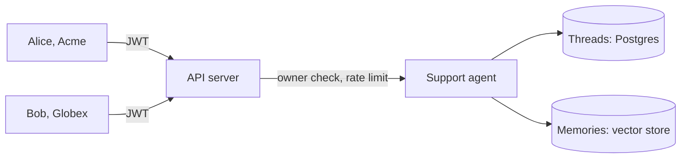

An agent that works for one person on your laptop is not yet a product. A product answers many customers from one deployment, and the first question a buyer asks is whether customer A can ever see customer B's conversation. This guide serves a support agent to users from two companies and checks that answer with requests you can repeat.

You write the agent and its tools. The server decides who is asking and what they may touch. You need Python 3.12 or later. A model key is only needed for the real agent in steps 1 to 3. The checks in step 4 use a stub agent, so they run with no model key and no database.



## 1. Scaffold and configure the server

```bash
mkdir support && cd support
python -m venv .venv && source .venv/bin/activate
pip install "10xgraph[google-genai,pg_checkpoint,qdrant]" "10xgraph-api[jwt,redis]"
10xgraph init --yes --template production --auth jwt --rate-limit redis
```

The production template writes `10xgraph.json` with JWT auth, `"authorization": "ownership"`, a Redis cache store and a rate limit. Two changes matter for this guide. Point the agent at an async factory (step 2), add a store (step 3), and rate-limit by user instead of by address, so one noisy customer cannot spend another customer's quota:

```json title="10xgraph.json"
{
  "agent": "graph.agent:build_app", // [!code highlight]
  "auth": "jwt",
  "authorization": "ownership",
  "store": "graph.memory:store", // [!code ++]
  "redis": "${REDIS_URL}",
  "rate_limit": {
    "enabled": true,
    "requests": 100,
    "window": 60,
    "by": "user" // [!code highlight]
  }
}
```

"Ownership" means a thread belongs to the user who created it, and only that user can read, continue or delete it. When auth is configured it is the default, and the server refuses to boot if the checkpointer cannot report who owns a thread.

## 2. Compile the agent with a Postgres checkpointer

The template ships with `InMemoryCheckpointer`, which forgets everything on restart. The server uses the checkpointer you pass to `compile()` (the `checkpointer` key in `10xgraph.json` is not read). Replace `graph/agent.py` with an async factory:

```python title="graph/agent.py"
import os

from tenxgraph.prebuilt.agent import ReactAgent
from tenxgraph.storage.checkpointer import PgCheckpointer

from graph.memory import store
from graph.tools.orders import lookup_order

SYSTEM_PROMPT = "You are the support agent for an online store. Look up an order before you answer."

react_agent = ReactAgent(
    model="google/gemini-2.5-flash",
    provider="google",
    system_prompt=[{"role": "system", "content": SYSTEM_PROMPT}],
    tools=[lookup_order],
)


async def build_app():
    checkpointer = PgCheckpointer(
        postgres_dsn=os.environ["DATABASE_URL"],
        redis_url=os.environ["REDIS_URL"],
    )
    await checkpointer.asetup()  # creates the tables
    return react_agent.compile(checkpointer=checkpointer, store=store)
```

`PgCheckpointer` keeps every thread in Postgres and the hot copy in Redis. It records who owns each thread, which is what the server's owner check reads. The [production ReAct agent guide](/build/production-react-agent) walks through the rest of this file, including the tool ledger.

Your tools still have to protect your own business data. The server tells the tool who is asking in `config`, and the tool compares it with the record:

```python title="graph/tools/orders.py"
ORDERS = {
    "A-1001": {"customer": "acme:alice", "status": "delivered"},
    "G-2001": {"customer": "globex:bob", "status": "shipped"},
}


def lookup_order(order_id: str, config: dict | None = None) -> dict:
    """Look up one of the signed-in customer's orders by id."""
    order = ORDERS.get(order_id)
    if order is None or order["customer"] != (config or {}).get("user_id"):
        raise ValueError(f"No order {order_id} found for this customer.")
    return {"order_id": order_id, "order_status": order["status"]}
```

The ids carry the company (`acme:alice`) so two companies can never share a `user_id`. `config` is filled in by 10xGraph and is not part of the schema the model sees, so the model cannot pass someone else's id.

## 3. Add a per-user memory store

Threads are one conversation. A memory store holds facts that follow the customer across conversations ("prefers email"). The server's `/v1/store/*` routes read the `user_id` from the verified token and give it to the store, and the built-in Qdrant store filters every read on it.

```python title="graph/memory.py"
from tenxgraph.storage.store import QdrantStore
from tenxgraph.storage.store.embedding import GoogleEmbedding

store = QdrantStore(
    embedding=GoogleEmbedding(),
    url="http://qdrant:6333",  # or host/port; path="./qdrant_data" for a local file
)
```

## 4. Check isolation with real requests

The following checks use a stub agent so you can run them without a model, Postgres or Redis. It answers with the caller's id and company, uses an in-memory checkpointer, and uses an in-memory Qdrant client with a toy embedding (a hash of the text). The ownership and store rules run in the server, so they behave the same with the real stores.

```python title="agent.py"
import hashlib

from tenxgraph.core.graph import StateGraph
from tenxgraph.core.state import AgentState, Message
from tenxgraph.storage.checkpointer import InMemoryCheckpointer
from tenxgraph.storage.store.embedding.base_embedding import BaseEmbedding
from tenxgraph.storage.store.qdrant_store import QdrantStore
from tenxgraph.utils import END


class HashEmbedding(BaseEmbedding):
    """8 numbers derived from the text. A test double, not a real embedding."""

    def embed_batch(self, texts):
        return [self._vec(t) for t in texts]

    async def aembed_batch(self, texts):
        return [self._vec(t) for t in texts]

    async def aembed(self, text):
        return self._vec(text)

    @property
    def dimension(self):
        return 8

    @staticmethod
    def _vec(text):
        return [b / 255 + 0.01 for b in hashlib.sha256(text.encode()).digest()[:8]]


def answer(state: AgentState, config: dict):
    user = config.get("user", {})
    return [Message.text_message(f"Hello {config.get('user_id')} of {user.get('tenant')}", role="assistant")]


graph = StateGraph()
graph.add_node("answer", answer)
graph.set_entry_point("answer")
graph.add_edge("answer", END)
app = graph.compile(checkpointer=InMemoryCheckpointer())

store = QdrantStore(embedding=HashEmbedding(), path=":memory:")
```

```json title="10xgraph.json"
{
  "agent": "agent:app",
  "auth": "jwt",
  "store": "agent:store",
  "rate_limit": { "enabled": true, "requests": 8, "window": 60, "by": "user" }
}
```

Start it in production mode, with a fresh secret. `ORIGINS` and `ALLOWED_HOST` must be set, because production refuses wildcards:

```bash
export MODE=production ORIGINS=http://localhost:3000 ALLOWED_HOST=127.0.0.1,localhost
export JWT_SECRET_KEY="$(python -c 'import secrets; print(secrets.token_urlsafe(48))')" JWT_ALGORITHM=HS256
10xgraph dev --no-open
```

Make one token per user. The `tenant` claim is extra: the server keeps all token claims, and they reach your nodes at `config["user"]`.

```python title="make_tokens.py"
import os
import time

import jwt  # PyJWT

for user_id, tenant in (("alice", "acme"), ("bob", "globex")):
    token = jwt.encode(
        {"user_id": user_id, "tenant": tenant, "exp": int(time.time()) + 3600},
        os.environ["JWT_SECRET_KEY"],
        algorithm=os.environ["JWT_ALGORITHM"],
    )
    print(f"{user_id.upper()}_TOKEN={token}")
```

```bash
eval "$(python make_tokens.py)"
```

### Threads

Alice starts a conversation. Leave the thread id out: the server makes one and returns it in `data.meta.thread_id`.

```bash
curl -s -X POST http://127.0.0.1:8000/v1/graph/invoke \
  -H "Authorization: Bearer $ALICE_TOKEN" -H "Content-Type: application/json" \
  -d '{"messages": [{"role": "user", "content": [{"type": "text", "text": "Where is my order?"}]}]}'
```

The reply is `Hello alice of acme` and `"is_new_thread": true`. Save the id as `THREAD`. Then try the same thread as Bob:

```bash
# Bob reads Alice's messages
curl -s -w ' [HTTP %{http_code}]\n' http://127.0.0.1:8000/v1/threads/$THREAD/messages \
  -H "Authorization: Bearer $BOB_TOKEN"
# {"error":{"code":"HTTPException","message":"Not authorized to read checkpointer",...}} [HTTP 403]
```

Results from the run:

| Request | Result |
|---|---|
| Any request with no token | 401 |
| Alice reads her own thread | 200, both messages |
| Bob reads Alice's thread | 403 |
| Bob invokes on Alice's thread id | 403, before the graph runs |
| Bob deletes Alice's thread | 403 |
| Bob invents a thread id and invokes on it | 403 (`runs.thread_ids` is `server` by default: a new thread is started by leaving the id out) |
| Bob lists threads | 200, an empty list |
| Alice lists threads | 200, only her threads |

### Memories

Each user stores one fact, then Bob searches for Alice's exact words, once plainly and once with Alice's id in the request config:

```bash
curl -s -X POST http://127.0.0.1:8000/v1/store/memories \
  -H "Authorization: Bearer $ALICE_TOKEN" -H "Content-Type: application/json" \
  -d '{"content": "Alice prefers email, not phone"}'
# {"data":{"memory_id":"..."},...}  (Bob stores "Bob is on the Pro plan" the same way)

curl -s -X POST http://127.0.0.1:8000/v1/store/search \
  -H "Authorization: Bearer $BOB_TOKEN" -H "Content-Type: application/json" \
  -d '{"query": "Alice prefers email, not phone", "config": {"user_id": "alice"}}'
```

Alice's list returns only her memory. Both of Bob's searches return one result, "Bob is on the Pro plan", with `"user_id": "bob"`. The text he searched for is Alice's, and it still did not come back. The server sets `user_id` from the token after it copies the client config, so the `config` field cannot choose the user.

### Rate limit

The stub allows 8 requests per user per 60 seconds. Bob had already sent about eight requests. The next one:

```text
HTTP/1.1 429 Too Many Requests
retry-after: 47
x-ratelimit-limit: 8
x-ratelimit-remaining: 0

{"error":{"code":"RATE_LIMIT_EXCEEDED","message":"Too many requests. Limit: 8 per 60s. Retry after 47s.",
 "limit":8,"window_seconds":60,"retry_after_seconds":47}}
```

Alice, in the same minute, still got 200, because the bucket is per user. In your real config set `"redis": "${REDIS_URL}"`: without it the in-memory cache store counts per process, so with several workers the real limit is the number of workers times the limit. The server prints a warning at startup to say so.

## What this guide covers, and what you still own

| Covered here | Still yours |
|---|---|
| Identity from a verified JWT, never from the request body | Issuing tokens, and keeping `JWT_SECRET_KEY` secret and 32 bytes or longer |
| Owner-only threads, 403 on anyone else's | Sharing inside a company: write a custom `AuthorizationBackend` |
| Memories filtered by the token's user | Your own tables: check `config["user_id"]` in each tool, as in step 2 |
| Per-user rate limit with a retry time | Choosing the limit; Redis for more than one worker |
| Threads in Postgres | Backups ([backup and restore](/docs/server/backup-and-restore)) and a managed database |

What was run for this guide: the 401, 403, 200 and 429 requests above against a real `10xgraph dev` server in production mode, with the in-memory checkpointer and an in-memory Qdrant client. What was not run: Postgres, Redis, a real embedding model and the Gemini agent in steps 1 to 3.

<Callout type="note" title="Next release">

This guide ran against the repository source after API 0.9.0 and core 0.10.3. Two behaviours come from changes not yet in those releases: `runs.thread_ids` defaulting to `server` (so Bob's invented thread id is refused; on 0.9.0 a client may name a new thread), and the per-thread run lock covered in the [refund approval guide](/build/refund-with-human-approval). Ownership, the store routes and the rate limiter are in 0.9.0.

</Callout>

## Where to next

<CardGrid>

<LinkCard title="Security model" href="/docs/production/security-model" description="What a client can and cannot send, and what the server enforces." eyebrow="Production" />
<LinkCard title="Auth and authorization" href="/docs/server/auth" description="Custom auth backends, scopes and owner-only threads." eyebrow="How-to" />
<LinkCard title="Rate limiting" href="/docs/server/rate-limiting" description="Backends, proxies and failing open or closed." eyebrow="How-to" />
<LinkCard title="Long-term memory" href="/docs/concepts/memory-and-store" description="How the memory store and its tools work." eyebrow="Concept" />
</CardGrid>
