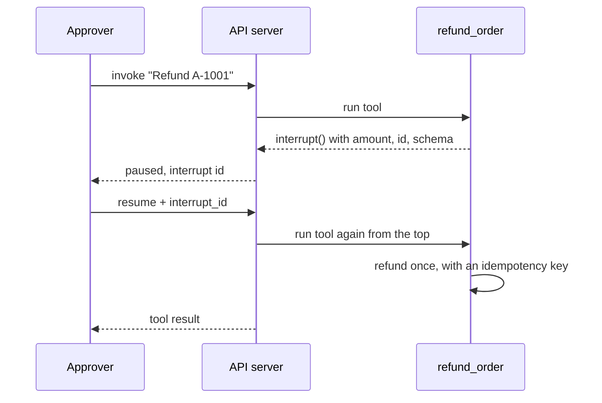

A support agent that can refund money should not spend it on its own say-so. The refund has to stop at a person, and it must not happen twice if the approval is clicked twice, the request is retried, or the process dies halfway through. This guide builds that path in the agent and checks each failure over the API.

You write one tool. The server provides the pause and resume endpoints, the checks on the answer, the one-run-per-thread lock and the owner check. Python 3.12 or later is required. A model key is needed for the real agent. The checks in step 4 use a stub that calls the same tools without a model.



## 1. Write the tool with interrupt()

`interrupt()` stops the run inside the tool, saves the request, and ends the call. When someone answers, the tool runs again from its first line, and `interrupt()` returns the answer instead of pausing. Because of that second run, **everything with a side effect goes after `interrupt()`**.

```python title="graph/tools/refunds.py"
from decimal import Decimal

from tenxgraph.utils import interrupt

from graph.payments import payments            # your payment client
from graph.tools.orders import _owned_order as owned_order  # raises unless the order is the caller's


def refund_order(order_id: str, config: dict | None = None) -> dict | str:
    """Refund a delivered order in full. A human approves first."""
    order = owned_order(order_id, config)
    if order["status"] != "delivered":
        raise ValueError(f"Order {order_id} is {order['status']}; only delivered orders can be refunded.")
    amount: Decimal = order["total"]

    decision = interrupt(
        value={"order_id": order_id, "amount": str(amount)},
        message=f"Approve a refund of {amount} for order {order_id}?",
        reason="tool_approval",
        response_schema={
            "type": "object",
            "properties": {"approved": {"type": "boolean"}, "note": {"type": "string"}},
            "required": ["approved"],
        },
    )
    if not decision or not decision.get("approved"):   # None means the client cancelled
        return "Refund declined by the reviewer."

    # Side effects only below this line. The key comes from the order, not the model's call id.
    refund = payments.refund(order_id, amount, idempotency_key=f"refund:{order_id}")
    return {"refunded": True, "refund_id": refund["refund_id"], "amount": str(amount)}
```

The ownership helper (`_owned_order`) and the fake `payments` client are the ones from the [production ReAct agent guide](/build/production-react-agent). The order is looked up before the pause, so a user cannot even get an approval prompt for someone else's order.

`response_schema` does two jobs. A front end can build its form from it, and the server rejects an answer that does not match it. The built-in check understands `type`, `enum`, `properties`, `required` and `items`. Other keywords are ignored, so do not rely on `minimum` or `pattern` here.

Register the tool as usual (`tools=[lookup_order, refund_order, notify_team]`) and compile with a durable checkpointer, as in the [multi-tenant guide](/build/multi-tenant-support-agent):

```python
return react_agent.compile(checkpointer=PgCheckpointer(postgres_dsn=dsn, redis_url=redis_url))
```

The pause is stored in the checkpoint. With `PgCheckpointer` it survives a restart of the server, and any worker can take the resume.

## 2. Start a run and read the pause

Ask for a refund. Add `"response_granularity": "full"` so the response includes the thread state, which carries the pause:

```bash
curl -s -X POST http://127.0.0.1:8000/v1/graph/invoke \
  -H "Authorization: Bearer $TOKEN" -H "Content-Type: application/json" \
  -d '{"messages": [{"role": "user", "content": [{"type": "text", "text": "Refund order A-1001"}]}],
       "response_granularity": "full"}'
```

The new thread id is in `data.meta.thread_id`. The pending request is at `data.state.execution_meta.interrupt_data.interrupt`:

```json
{
  "id": "int_fdc31f3efa66437fb5e7d45ae0a335d3",
  "key": "tool:c1:0",
  "node": "TOOL",
  "value": { "order_id": "A-1001", "amount": "49.00" },
  "message": "Approve a refund of 49.00 for order A-1001?",
  "reason": "tool_approval",
  "response_schema": { "type": "object", "properties": { "approved": { "type": "boolean" }, "note": { "type": "string" } }, "required": ["approved"] },
  "tool_call_id": "c1"
}
```

Save `id` and the thread id. The same data arrives on `/v1/graph/stream` as an `updates` event with `status: "interrupted"`. See [Interrupts](/docs/concepts/interrupts) for the stream and WebSocket forms.

## 3. Approve over the API

Resume with the answer, the interrupt id, and the thread id. The id binds the answer to this one question, so a retry or a stale tab cannot answer a different prompt:

```bash
curl -s -X POST http://127.0.0.1:8000/v1/graph/invoke \
  -H "Authorization: Bearer $TOKEN" -H "Content-Type: application/json" \
  -d '{"resume": {"approved": true},
       "interrupt_id": "int_fdc31f3efa66437fb5e7d45ae0a335d3",
       "config": {"thread_id": "THREAD_ID"}}'
```

The response carries the messages of the run, including the tool result `{"refunded": true, "refund_id": "re_1", "amount": "49.00"}`. To decline, send `{"approved": false}`. To cancel, send `"resume": null`. Both reach the tool as shown in step 1.

## 4. Break it on purpose

The requests below ran against a real `10xgraph dev` server in production mode with JWT auth. The agent was a stub with no model: a node that asks for `refund_order` and `notify_team` in one turn, an in-memory checkpointer, and a fake payment provider and team channel that count their calls. `notify_team` posts a message and, like many real calls, is not idempotent. The server log showed one provider call and one team post for the approved thread.

| What the caller does | Response |
|---|---|
| Resume with the wrong `interrupt_id` | **409** `interrupt_id 'int_wrong' does not match the open interrupt 'int_fdc3...'` |
| Resume with `{"approved": "yes"}` | **422** `Resume value does not match the response schema of interrupt '...': $.approved: expected boolean, got str` |
| A different user resumes the thread | **403** `Not authorized to invoke graph`, before the graph starts |
| The right user resumes with `{"approved": true}` | **200**, the refund ran once |
| The same answer is sent again | **409** `Nothing to resume: this thread is not paused at an interrupt` |
| A new user message is sent to a paused thread | **422** (a generic "Invalid input provided." in production): a paused thread wants an answer, not a message |
| `{"approved": false}` | **200**, the tool returned "Refund declined by the reviewer.", the provider was never called |

The 409 for a stale answer and the 422 for a bad one are checked before the tool runs. Nothing is recorded when they fire.

### The tool ran twice. Did the refund?

On resume, the tool node runs again from its first line, so `refund_order` is called a second time. In the stub, the model asks for two tools in one turn, and `notify_team` had already finished in the first run, and the server log shows `TEAM POST #1` once for this thread, not twice. A finished tool call is written to the checkpointer's tool ledger as soon as it returns, under a key made of the assistant message id and the tool call id, and a re-run takes the recorded result instead of calling the tool.

The same ledger covers a crash. If a worker dies after the refund went out but before the step finished, the next run of that step finds the recorded result and does not call `refund_order` again. Read [Replay-safe tools](/docs/concepts/replay-safe-tools) for the limits, which are real:

- A crash before the tool returns, or in the moment between the return and the ledger write, can run it again. That is why `refund_order` sends `idempotency_key=f"refund:{order_id}"` to the provider. Keep both layers.
- The ledger needs a checkpointer that implements it. `PgCheckpointer` stores it in Postgres. `InMemoryCheckpointer` keeps it in the process, so it does not survive a restart, and `SqliteCheckpointer` has no ledger.
- Streamed runs do not use the ledger.

I did not kill a process mid-run for this guide, and I did not run Postgres. The skip on re-run was observed in-process, as above. The survive-a-restart claim rests on the Postgres ledger described in the concept page and the core tests, not on a run here.

### Two requests, one thread

Start a run with a tool that takes a while, then send a second request to the same thread while it is still going. The second request waits up to 30 seconds for the first, and then gets:

```text
HTTP 409
{"error":{"code":"HTTPException","message":"thread is busy", ...}}
```

In the test the slow run lasted 40 seconds, and the second request returned 409 about 30 seconds after it was sent. This is the guard against a double click, two tabs, or a retry that arrives while the first attempt is still working: only one run per thread at a time. Add `"on_busy": "cancel"` next to `recursion_limit` in the request to ask the running run to stop instead of waiting (documented in the API changelog; not run for this guide). With Redis configured the lock is shared across workers, and it expires by itself if a worker dies.

<Callout type="note" title="Next release">

Releases 0.10.3 (core) and 0.9.0 (API) have `interrupt()`, `resume`, the tool ledger and the owner check. These parts come after them: `interrupt_id` on the request and the matching 409 and 422 above, the per-thread run lock with its 409 and `on_busy`, and the owner scoping of ledger reads in `PgCheckpointer`. Without them, a resume is answered without the id check, and parallel requests on a thread are not queued. The responses above are from the repository source.

</Callout>

## What this guide covers, and what you still own

| Covered here | Still yours |
|---|---|
| A pause before money moves, saved in the checkpoint | Who the approver is: owner-only by default, a custom `AuthorizationBackend` for reviewers |
| An answer tied to one interrupt and checked against a schema | The rules inside your tool, such as limits above which a second approver is needed |
| A recorded tool call is not re-run after a replay | An idempotency key in the call to the payment provider |
| One run per thread, 409 otherwise | Telling your front end to treat 409 as "someone else is already working on this" |
| Ownership checks on every thread request | A durable checkpointer and backups for the approval state |

## Where to next

<CardGrid>

<LinkCard title="Interrupts" href="/docs/concepts/interrupts" description="interrupt(), resume, schemas and the stream and WebSocket forms." eyebrow="Concept" />
<LinkCard title="Add human approval" href="/docs/guides/add-human-approval" description="Task-focused version with UI wiring." eyebrow="How-to" />
<LinkCard title="Replay-safe tools" href="/docs/concepts/replay-safe-tools" description="What the ledger guarantees and what it does not." eyebrow="Concept" />
<LinkCard title="Scaling and reliability" href="/docs/production/scaling" description="Run caps, locks and failure behaviour across workers." eyebrow="Production" />
</CardGrid>
