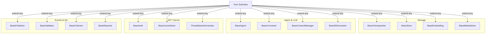

Storage, auth, LLM integration, IDs, events and evaluation are each defined by an abstract base class. Subclass one and pass the instance in; graph logic does not change.

## Extension points at a glance



| ABC | File | What you override |
|---|---|---|
| `BaseAgent` | `tenxgraph/core/graph/base_agent.py` | `execute()`, `_call_llm()` |
| `BaseContextManager` | `tenxgraph/core/state/base_context.py` | `trim_context()` (sync or async) |
| `BaseCheckpointer` | `tenxgraph/storage/checkpointer/base_checkpointer.py` | Async state, cache, message and thread methods, and `aping()` |
| `BaseStore` | `tenxgraph/storage/store/base_store.py` | `astore()`, `asearch()`, `aget()`, `aget_all()`, `aupdate()`, `adelete()`, `aforget_memory()`, `aping()` |
| `BaseEmbedding` | `tenxgraph/storage/store/embedding/base_embedding.py` | `aembed()`, `aembed_batch()`, `dimension` |
| `BaseMediaStore` | `tenxgraph/storage/media/storage/base.py` | `store()`, `retrieve()`, `delete()`, `exists()` |
| `BasePublisher` | `tenxgraph/runtime/publisher/base_publisher.py` | `publish(EventModel)`, `close()`, `sync_close()` |
| `BaseConverter` | `tenxgraph/runtime/adapters/llm/base_converter.py` | `convert_response()`, `convert_streaming_response()` |
| `BaseValidator` | `tenxgraph/utils/callbacks.py` | `async validate(messages)` |
| `BaseIDGenerator` | `tenxgraph/utils/id_generator.py` | `id_type`, `generate()` |
| `BaseAuth` | `tenxgraph_api/src/app/core/auth/base_auth.py` | `authenticate(request, response, credential)`, optional `authorize(identity, permission, resource=None)` |
| `BaseCacheStore` | `tenxgraph_api/src/app/core/cache_store/base.py` | `aping()`, `now()`, `acquire()`, `renew()`, `release()`, `get()`, `set()`, `delete()` |
| `ThreadNameGenerator` | `tenxgraph_api/src/app/utils/thread_name_generator.py` | `generate_name(messages)` |
| `BaseCriterion` | `tenxgraph/qa/evaluation/criteria/base.py` | `async evaluate(actual, expected)` |
| `BaseReporter` | `tenxgraph/qa/evaluation/reporters/base.py` | `generate(report, output_dir=None)` |

## Common extension pattern

1. Subclass the ABC and implement its abstract methods.
2. Pass the instance when building the graph (such as `graph.compile(checkpointer=...)` or `StateGraph(publisher=...)`) or set the path in `10xgraph.json` for server-layer ABCs. A checkpointer always goes to `compile()`: the server does not apply the checkpointer key in `10xgraph.json` yet.
3. The framework picks it up. Graph logic, routing, and API endpoints are unchanged.

## Storage extension points

The checkpointer, store and media store are passed to `compile()`; an embedding model is passed to the store.

### BaseCheckpointer: conversational state

Extend `BaseCheckpointer` to keep thread state in another database. Every async method is abstract; the sync wrappers come from the base class. A full skeleton is in the [checkpointers reference](/docs/reference/python/checkpointers).

Reference: [BaseCheckpointer](/docs/reference/python/checkpointers) · Source: [base_checkpointer.py](https://github.com/10xGraph/10xGraph/blob/main/tenxgraph/storage/checkpointer/base_checkpointer.py)

### BaseStore: long-term vector memory

Extend `BaseStore` to keep long-term memory in another vector database.

Reference: [BaseStore](/docs/reference/python/memory-stores) · Source: [base_store.py](https://github.com/10xGraph/10xGraph/blob/main/tenxgraph/storage/store/base_store.py)

```python
from tenxgraph.storage.store.base_store import BaseStore

class PineconeStore(BaseStore):
    async def astore(self, config, content, memory_type=..., category="general", metadata=None, **kwargs) -> str: ...
    async def asearch(self, config, query, memory_type=None, category=None, limit=10, **kwargs) -> list: ...
    async def aget(self, config, memory_id, **kwargs): ...
    async def aget_all(self, config, limit=100, **kwargs) -> list: ...
    async def aupdate(self, config, memory_id, content, metadata=None, **kwargs): ...
    async def adelete(self, config, memory_id, **kwargs): ...
    async def aforget_memory(self, config, **kwargs): ...
    async def aping(self) -> None: ...   # raise if the backend is unreachable; read-only and cheap

compiled = graph.compile(store=PineconeStore())
```

`aping` is abstract: a store that does not implement it raises `TypeError` when created. Return when the backend is reachable and raise otherwise; an in-process store just returns. `10xgraph-api` calls it for `/health/ready` and at startup.

### BaseEmbedding: custom embedding model

Implement `aembed()`, `aembed_batch()` and the `dimension` property to use another embedding model. Example: [BaseEmbedding reference](/docs/reference/python/memory-stores#baseembedding).

### BaseMediaStore: file storage backend

Extend `BaseMediaStore` to keep uploaded images, audio and documents in your own file storage.

```python
from tenxgraph.storage.media.storage.base import BaseMediaStore

class S3MediaStore(BaseMediaStore):
    async def store(self, data: bytes, mime_type: str, metadata: dict | None = None) -> str:
        """Store bytes and return an opaque storage key."""
        ...

    async def retrieve(self, storage_key: str) -> tuple[bytes, str]:
        """Return (bytes, mime_type)."""
        ...

    async def delete(self, storage_key: str) -> bool:
        """Delete by storage key. Return True if deleted."""
        ...

    async def exists(self, storage_key: str) -> bool: ...
```

## Agent and LLM extension

### BaseAgent: bring your own LLM

`Agent` extends `BaseAgent`. Subclass it to call a provider that 10xGraph does not support.

```python
from tenxgraph.core.graph.base_agent import BaseAgent
from tenxgraph.core.state import AgentState, Message

class MyProviderAgent(BaseAgent):
    async def execute(self, state: AgentState, config: dict, *, request_blocks=None) -> Message:
        # Convert 10xGraph messages to your provider's format
        messages = [
            {"role": m.role, "content": m.text()}
            for m in state.context
            if m.role in ("user", "assistant")
        ]
        response = await my_client.chat(
            model="my-model",
            messages=messages,
        )
        return Message.text_message(response.text, role="assistant")

    async def _call_llm(self, messages, tools=None, **kwargs):
        # Also abstract: the low-level provider call
        ...
```

### BaseConverter: LLM response normalization

`BaseConverter` maps a raw provider response into 10xGraph's `Message` format. You implement one when integrating a provider whose output shape needs normalizing into the framework's message format.

```python
from tenxgraph.core.state import Message
from tenxgraph.runtime.adapters.llm.base_converter import BaseConverter

class MyProviderConverter(BaseConverter):
    async def convert_response(self, response) -> Message:
        return Message.text_message(response["output"], role="assistant")

    async def convert_streaming_response(self, config, node_name, response, meta=None):
        # async generator yielding EventModel or Message
        async for chunk in response:
            text = chunk.get("delta", "")
            if text:
                yield Message.text_message(text, role="assistant")
```

### BaseContextManager: custom context trimming

Implement one method, `trim_context`, as `async def` (recommended) or `def`, when the built-in trimming does not fit. See [Use a context manager](/docs/guides/use-context-manager).

```python
from tenxgraph.core.state.base_context import BaseContextManager
from tenxgraph.core.state import AgentState

class PriorityContextManager(BaseContextManager):
    async def trim_context(self, state: AgentState) -> AgentState:
        # keep system message + last N turns + any pinned messages
        ...
        return state

graph = StateGraph(state=MyState(), context_manager=PriorityContextManager())
```

## ID generation

| Class | Output |
|---|---|
| `DefaultIDGenerator` | UUID v4 string (used when none is set) |
| `UUIDGenerator` | Deprecated alias of `DefaultIDGenerator`, removed in 2.0 |
| `BigIntIDGenerator` | Big integer |
| `IntIDGenerator` | Random integer that fits a signed 32-bit column |
| `TimestampIDGenerator` | Integer of microseconds since the Unix epoch |
| `HexIDGenerator` | Hex string |
| `ShortIDGenerator` | 8-character alphanumeric string |
| `AsyncIDGenerator` | Deprecated, removed in 2.0. Subclass `BaseIDGenerator` with an `async def generate()` instead |

Extend `BaseIDGenerator` (`id_type` and `generate()`) for your own format. See [Configure the ID generator](/docs/guides/configure-id-generator).

```python
from tenxgraph.utils.id_generator import TimestampIDGenerator

graph = StateGraph(id_generator=TimestampIDGenerator())
compiled = graph.compile()
```

## API and server extension

Server-layer ABCs are set in `10xgraph.json`.

### BaseAuth

Extend `BaseAuth` for authentication other than JWT. `authenticate(request, response, credential)` is `async`; return a dict with at least `user_id`, or raise to reject.

Reference: [BaseAuth](/docs/reference/api-cli/auth) · Source: [base_auth.py](https://github.com/10xGraph/10xgraph-api/blob/main/tenxgraph_api/src/app/core/auth/base_auth.py)

```python
from tenxgraph_api import BaseAuth

class ApiKeyAuth(BaseAuth):
    async def authenticate(self, request, response, credential) -> dict | None:
        key = request.headers.get("X-API-Key")
        return lookup_api_key(key)   # dict with user_id; raise an exception to reject
```

### Custom authorization rules

Override `BaseAuth.authorize` when the built-in role-based permissions do not fit your model. It takes the `Identity`, a `resource:action` permission and an optional resource id, and it takes no request, so background jobs can call it too.

```python
from tenxgraph_api import BaseAuth

class PolicyAuth(BaseAuth):
    async def authenticate(self, request, response, credential) -> dict | None:
        ...  # verify the credential, return claims with user_id

    async def authorize(self, identity, permission, resource=None) -> bool:
        return await policy_engine.allowed(identity.user_id, permission, resource)
```

For simple role-to-permission mapping, you do not need a class. Add `roles` to the `auth` object. See [Authentication and authorization](/docs/server/auth).

### BaseCacheStore

The API keeps everything it shares between workers in one `BaseCacheStore`: the per-thread run lock, run and WebSocket caps, idempotency, token revocation and rate-limit counters. `RedisCacheStore` is used when `cache_store.type` is `redis` (Valkey, Dragonfly and KeyDB work through the URL); `InMemoryCacheStore` is the default for one process. You extend `BaseCacheStore` when the shared state has to live in something that does not speak the Redis protocol.

Reference: [BaseCacheStore](/docs/reference/api-cli/cache-store) · Source: [base.py](https://github.com/10xGraph/10xgraph-api/blob/main/tenxgraph_api/src/app/core/cache_store/base.py)

The contract is strict (atomic `acquire`, TTLs never dropped early, no eviction). The full rules, a skeleton and the contract test suite are on [Bring your own backend](/docs/server/bring-your-own-backend).

### ThreadNameGenerator

Extend `ThreadNameGenerator` for custom thread names; without one, the server makes adjective-noun names.

```python
from datetime import date

from tenxgraph_api import ThreadNameGenerator

class DatePrefixNameGenerator(ThreadNameGenerator):
    async def generate_name(self, messages: list[str]) -> str:
        return f"{date.today()}: {messages[0][:30]}"
```

Wire any of these in `10xgraph.json`. Auth (with its authorization rules), thread naming and the cache store each have a dedicated top-level key:

```json
{
  "auth": { "method": "custom", "path": "auth.my_auth:ApiKeyAuth" },
  "thread_name_generator": "services.naming:DatePrefixNameGenerator",
  "cache_store": { "type": "custom", "path": "services.cache:store" }
}
```

The string format for class references is `module.path:ClassName` (dot-separated module path, colon, then the class or instance name). `cache_store.path` accepts an instance or a zero-argument factory (a class or function) that returns one.

## Event stream extension

Extend `BasePublisher` to send events to your own endpoint. Multiple publishers can run together: pass a list to `StateGraph(publisher=[...])` or wrap them in `CompositePublisher`. A custom publisher is an event publisher (`kind = "events"`) by default. Set `kind = "observability"` for a custom tracing backend. See [Publishers, AI tracing and metrics](/docs/concepts/events-and-observability#publishers-ai-tracing-and-metrics).

A full `WebhookPublisher` example is in the [publishers reference](/docs/reference/python/publishers).

Compose multiple publishers:

```python
from tenxgraph import StateGraph
from tenxgraph.runtime.publisher import CompositePublisher, ConsolePublisher

graph = StateGraph(
    publisher=CompositePublisher([ConsolePublisher(), WebhookPublisher("https://...")])
)
compiled = graph.compile()
```

## Validation and evaluation extension

### BaseValidator: input screening

Extend `BaseValidator` to check input before it reaches the graph, and register it with `CallbackManager.register_input_validator`. Examples: [Security and validators](/docs/concepts/security-and-validators).

### BaseCriterion: custom evaluation criterion

Extend `BaseCriterion` (`async evaluate(actual, expected)`) to score runs your own way. Example: [Evaluation criteria](/docs/reference/python/evaluation-criteria).

### BaseReporter: custom evaluation report

Extend `BaseReporter` to write evaluation reports in your own format or send them elsewhere.

```python
from tenxgraph.qa.evaluation.reporters.base import BaseReporter

class SlackReporter(BaseReporter):
    def generate(self, report, output_dir: str | None = None) -> str | None:
        summary = f"Pass rate: {report.summary.pass_rate:.2f}"
        post_to_slack("#evals", summary)  # your own helper
        return summary
```

## What's next

| Page | What it covers |
|---|---|
| [Callbacks and Command](/docs/concepts/callbacks-and-command) | BaseValidator, CallbackManager, GraphLifecycleHook in practice |
| [Serving Agents](/docs/concepts/serving-agents) | BaseAuth, BasePublisher wired to a running server |
| [Long-term memory](/docs/concepts/memory-and-store) | BaseStore and BaseEmbedding in the memory layer |
| [Testing and evaluation](/docs/testing) | BaseCriterion, BaseReporter in the evaluation pipeline |
