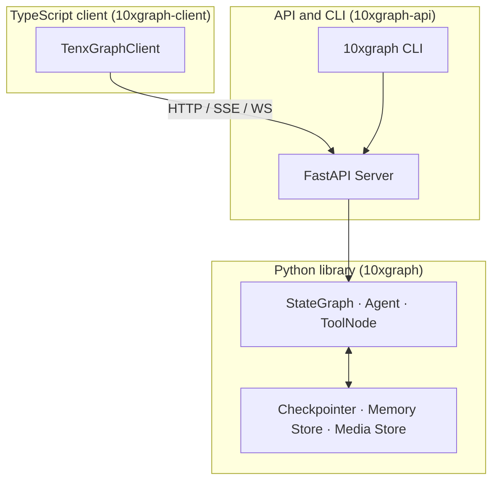

10xGraph is open-source, self-hosted infrastructure for AI applications. You write the agents, tools and tasks; 10xGraph runs them behind an API server with authentication, role-based access, tenant isolation, durable state in Postgres and Redis, background jobs, metrics and tracing, and generates Docker and Kubernetes deploy files.

This section explains both halves. Around your code sit the API server, [security and access](/docs/concepts/tenancy-and-access), [data and state](/docs/concepts/checkpointing-and-threads), [background jobs](/docs/jobs), [observability](/docs/concepts/events-and-observability) and deployment. Inside it is the agent model: a graph of nodes that share state and messages. Read the pages in either order. For what the server gives you once your agent is built (auth, limits, durability, scaling), go to [Platform](/docs/production).

## Three-layer architecture

10xGraph is built in three independent layers. You can use just the Python library for agents in a script, or add the API server and TypeScript client to serve agents over HTTP.

| Layer | Package | What it does |
|-------|---------|-------------|
| **Core library** | `10xgraph` (import `tenxgraph`) | Graph engine, agents, tools, state, checkpointing, memory stores, media handling, publishers. Use this to build agents locally or embed graphs in your own apps. |
| **API server & CLI** | `10xgraph-api` (import `tenxgraph_api`, command `10xgraph`) | FastAPI server that wraps your compiled graph, REST and WebSocket endpoints, auth, authorization, rate limiting, thread management. Use this to serve agents over HTTP. |
| **TypeScript client** | `10xgraph-client` (npm `10xgraph-client`) | Typed HTTP wrapper for browser and Node.js, handles auth, streaming, thread management, file uploads. Use this to call the server from your frontend or backend. |

For what happens to one HTTP request, see [Serving agents](/docs/concepts/serving-agents); for streaming, see [Streaming](/docs/concepts/streaming).

## The execution model

Inside your code, an agent is a graph: nodes (functions, `Agent`, `ToolNode`) connected by edges, all reading and writing one shared state whose `context` holds the conversation as `Message` objects. Start with [StateGraph](/docs/concepts/state-graph), then [State and messages](/docs/concepts/state-and-messages).

## What's in this section

### Foundations

Start here to understand the execution model in depth: state graphs, messages, agents, tools, routing, dependency injection, and streaming.

- [StateGraph](/docs/concepts/state-graph): The core workflow engine, how compile() wires everything, and recursion limits.
- [State and messages](/docs/concepts/state-and-messages): Message structure, content blocks, state reducers, and the message catalog.
- [Agents and tools](/docs/concepts/agents-and-tools): Why Agent exists, how ToolNode dispatches (parallel by default), MCP, and tool errors.
- [Choosing a building block](/docs/concepts/choosing-a-building-block): When to use a plain node vs Agent vs prebuilt agent vs custom graph.
- [Routing, Command and callbacks](/docs/concepts/callbacks-and-command): Conditional edges, the Command API, and callback handling.
- [Interrupts](/docs/concepts/interrupts): Human-in-the-loop: pausing execution, saving checkpoints, and resuming.
- [Dependency injection](/docs/concepts/dependency-injection): Why DI vs globals, and the injectable parameters you can request.
- [Streaming](/docs/concepts/streaming): Python streaming granularity, why stream, and transport summary.

### Platform: serving, access and operations

What runs around your code: the API server, who may do what, tenant isolation, background jobs, the shared cache store, observability, media handling, and extensibility.

- [Serving agents](/docs/concepts/serving-agents): How the API server loads graphs, request lifecycle, server processes, and config vs code.
- [Tenancy and access](/docs/concepts/tenancy-and-access): Identity, roles, reach, tenant columns and row-level security.
- [Background jobs](/docs/jobs): In-process tasks vs the TaskIQ worker and scheduler.
- [Cache store](/docs/concepts/cache-store): Run locks, idempotency, revocation and rate-limit counters.
- [Security and validators](/docs/concepts/security-and-validators): Input validation, authorization models, and reach.
- [Events and observability](/docs/concepts/events-and-observability): The event model, publishers, metrics, and tracing.
- [Remote tools](/docs/concepts/remote-tools): When to use remote tool execution.
- [Media and files](/docs/concepts/media-and-files): Media refs, offload policies, storage backends, and provider file APIs.
- [Extension points](/docs/concepts/extensibility): The base classes you can subclass: BaseAgent, BaseCheckpointer, BaseStore, BaseAuth, and more.

### Memory and reliability

Build robust agents: checkpointing threads, long-term memory stores, context trimming, error handling, and tool replay safety.

- [Checkpointing and threads](/docs/concepts/checkpointing-and-threads): Threads, checkpoints, and choosing a checkpointer (in-memory, SQLite, Postgres+Redis).
- [How PgCheckpointer works](/docs/concepts/memory): The dual-layer write and read paths, versioning, and recovery.
- [Long-term memory](/docs/concepts/memory-and-store): Store vs checkpointer, retrieval, scoping, and when to use memory tools.
- [Context management](/docs/concepts/context-management): Why context grows, message trimming vs summarization, and trade-offs.
- [Replay-safe tools](/docs/concepts/replay-safe-tools): How tool ledgers prevent duplicate execution on resume.
- [Errors and limits](/docs/concepts/errors-and-limits): Exception types, recursion limits, timeouts, and retry policies.

## Next steps

- [Get started](/docs/get-started): Build your first agent, step by step.
- [Build agents](/docs/guides): Task guides for everything from custom nodes to prebuilt agents to production patterns.
- [API server](/docs/server): Serve agents over HTTP with auth, rate limiting, and observability.
- [TypeScript client](/docs/client): Call the server from your app with the typed client.
- [Reference](/docs/reference): API signatures, CLI flags, environment variables, and error codes.
