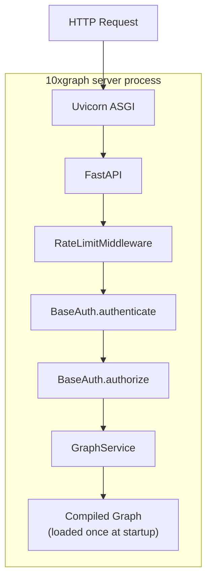

The 10xGraph API server serves one compiled graph over HTTP and WebSocket. For the summary of what you get when you serve with `10xgraph-api`, see [Production readiness](/docs/production).

## How the server loads and runs your graph



The API server is a Uvicorn ASGI process that loads your compiled graph **once at startup** and reuses it for every request. The graph itself is stateless; per-request isolation comes from the `thread_id` in the request. In development, `10xgraph dev` auto-restarts on file changes (`--no-reload` turns that off). In production, the image from `10xgraph build` runs Gunicorn with multiple workers; put them behind a load balancer and use `PgCheckpointer` to share state across them.

## Configuration: `10xgraph.json`

`10xgraph.json` is the single file that wires everything together. The CLI and API server read it at startup to determine which graph to load, which auth to use, and how to configure every service.

Import paths are **dotted module paths** (`module:attribute`), resolved with `importlib`, not file paths.

**Minimal example:**

```json
{
  "agent": "graph.agent:get_compiled_graph",
  "auth": "jwt",
  "cache_store": {
    "rate_limit": {"requests": 100, "window": 60}
  }
}
```

Every key, with its type and default, is in the [configuration reference](/docs/reference/api-cli/configuration). The server does not load the `checkpointer` key; pass the checkpointer to `compile(checkpointer=...)` in your graph module.

Start it with `10xgraph dev`; see [Run the server](/docs/server/run-the-server).

## Request flow

The routes are listed in [API routes by function](/docs/server#api-routes-by-function).

When configured, rate limiting runs first as middleware. Each protected route then runs authentication (`BaseAuth.authenticate`) and authorization (`BaseAuth.authorize`, which defaults to the built-in role-based permission check) before the handler. If no `auth` is configured, authentication and authorization are skipped and every request runs as an anonymous user.

Execution events go to the publishers your graph was built with; see [Events and observability](/docs/concepts/events-and-observability).

## Authentication and authorization

`auth` in `10xgraph.json` selects `none`, the built-in JWT auth (`"auth": "jwt"`) or your own `BaseAuth` subclass. After the caller is identified, every route checks one `resource:action` permission (for example `graph:invoke`) against the caller's role, and the caller's reach (`own`, `tenant`, `all`) limits which threads and memories it sees. See [Authentication and authorization](/docs/server/auth) and [Tenancy and access](/docs/concepts/tenancy-and-access).

## Rate limiting

Rate limiting keeps its counters in the API's cache store (`cache_store.rate_limit`). Use `"type": "redis"` when you run several workers. See [Rate limiting](/docs/server/rate-limiting).

## Dependency injection

The server runs one graph with one InjectQ container. Pass the same container to `StateGraph(container=...)` and name it in `injectq` in `10xgraph.json` (or set neither, and both use the global container); a mismatch refuses to boot. See [Dependency injection](/docs/concepts/dependency-injection).

## Production deployment

For production, `10xgraph build` generates the Docker files and the image runs Gunicorn with several workers; share state between them with `PgCheckpointer` and a Redis cache store. See [Deploy](/docs/server/deploy) and the [environment reference](/docs/reference/api-cli/environment).

## What's next

Read the [API server guide](/docs/server) for tasks like configuring auth, setting up multi-worker deployments, and monitoring production systems. See the [Memory](/docs/concepts/memory) page to understand checkpointing and the long-term store. The [Extensibility](/docs/concepts/extensibility) page lists the extension points. Tracing is set up in [Observability](/docs/server/observability).
