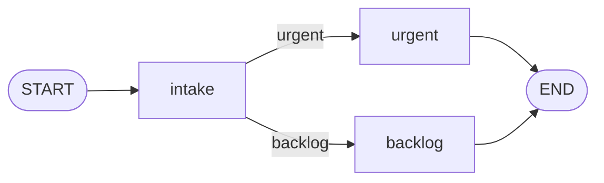

A `StateGraph` models an agent as a directed graph: nodes (functions, agents or tool dispatchers) connected by edges, all reading and writing one shared state. You define the structure, call `compile()` to validate it, then run it with `invoke()` for a final result or `stream()` for incremental output. A recursion limit stops runaway loops.



## What are the parts of a graph?

| Part | What it is | How you add it |
|---|---|---|
| Node | A function, `Agent` or `ToolNode` that receives state and returns an update | `add_node(name, func)` |
| Static edge | Always go from node A to node B | `add_edge(a, b)` |
| Conditional edge | A function inspects state and picks the next node | `add_conditional_edges(a, fn, path_map)` |
| `START` | Virtual node where a run begins | `add_edge(START, "first")` or `set_entry_point("first")` |
| `END` | Virtual node that finishes the run | `add_edge("last", END)` |
| State | An `AgentState` (or subclass) shared by all nodes | `StateGraph(MyState())` |

`START` and `END` live in `tenxgraph.utils.constants`. Nodes you register may return a `Message`, a list of messages, a plain string (stored as an assistant message), an `AgentState`, a dict of state field updates, `None` (no change) or a `Command`.

### Nested graphs are not supported

A compiled graph cannot be a node of another `StateGraph`. `add_node` accepts only a function (sync or async), a `ToolNode` or an `Agent`. Passing a compiled graph raises `ValueError: Invalid arguments for add_node`.

To reuse a workflow inside another, wrap it as a tool. The tool runs the sub-workflow (plain code, or a second compiled graph it calls with `ainvoke`), stores the full intermediate data in a custom state field and returns a short summary to the model. A custom state field is saved per thread with the checkpoint and is not sent to the model unless you put it in the prompt, so the model context does not grow. See [Run a sub-workflow as a tool call](/docs/guides/handoff-between-agents#run-a-sub-workflow-as-a-tool-call) for a full example.

For several agents that share one conversation, use one graph with several `Agent` nodes, connected by edges, conditional edges, `Command(goto=...)` or handoff tools. See [Route between agents with handoff](/docs/guides/handoff-between-agents).

## How do I build a graph?

This example builds a support ticket triage graph. Each node is a function that receives the shared state and returns an update (either a string, a dict, or a list of messages). The conditional edge routes based on the ticket content.

```python title="triage.py"
from tenxgraph.core import StateGraph
from tenxgraph.core.state import AgentState, Message
from tenxgraph.storage.checkpointer import InMemoryCheckpointer
from tenxgraph.utils.constants import START, END

def intake(state: AgentState, config: dict) -> str:
    """First node: log the intake and prepare for routing."""
    return "Ticket received and queued for triage."

def handle_urgent(state: AgentState, config: dict) -> str:
    """Route path for urgent tickets: page on-call."""
    return "Escalating to on-call engineer. Incident ticket #12345."

def route_to_backlog(state: AgentState, config: dict) -> str:
    """Route path for non-urgent: file in backlog."""
    return "Ticket filed in product backlog for Q4 planning."

def decide_priority(state: AgentState) -> str:
    """Conditional function: returns the node name to visit next."""
    # Extract user message and check urgency indicator
    user_messages = [m for m in state.context if m.role == "user"]
    if not user_messages:
        return "backlog"  # default
    
    text = user_messages[-1].text().lower()
    return "urgent" if "outage" in text or "down" in text else "backlog"

# Build the graph structure
graph = StateGraph()
graph.add_node("intake", intake)
graph.add_node("urgent", handle_urgent)
graph.add_node("backlog", route_to_backlog)

# Set entry point (adds edge from START automatically)
graph.set_entry_point("intake")  # [!code highlight]

# Conditional edge: the function returns a key, path_map maps it to node name
graph.add_conditional_edges(
    "intake",
    decide_priority,
    {"urgent": "urgent", "backlog": "backlog"},  # [!code highlight]
)

# Terminal edges: both outcome paths lead to END
graph.add_edge("urgent", END)
graph.add_edge("backlog", END)

# Compile the graph: validates structure, binds runtime services
app = graph.compile(checkpointer=InMemoryCheckpointer())

# Run the graph
result = app.invoke(
    {"messages": [Message.text_message("AWS region down - checkout failing")]},
    config={"thread_id": "ticket-prod-001"},
)

# Print the final message (last state update)
print("Outcome:", result["messages"][-1].text())
```

**Key points:**

- `set_entry_point("intake")` adds an implicit edge from `START` to "intake", so the graph always begins there.
- The conditional edge's routing function `decide_priority` inspects the state and returns a string key ("urgent" or "backlog"), not a node name. The `path_map` dict maps that key to the actual node name.
- If you omit the `path_map`, the routing function must return the node name directly (e.g., return `"urgent"` instead of returning a key that the map looks up).

## How does state work?

Every run starts from an `AgentState`. Its main field is `context`, the list of messages, and it uses a reducer (`add_messages`) so new messages are appended rather than replacing the list. `AgentState` also carries `context_summary` and internal `execution_meta` that the runtime uses for steps, interrupts and resume.

Add your own fields by subclassing, then pass an instance to the graph:

```python title="state.py"
from tenxgraph.core.state import AgentState

class TicketState(AgentState):
    customer_tier: str = "free"
```

```python
graph = StateGraph(TicketState())
```

`StateGraph(state=None, ...)` creates a plain `AgentState` when you pass nothing. It also accepts `context_manager`, `publisher`, `id_generator` and `container` (an InjectQ container) for trimming context, emitting events, generating ids and dependency injection.

## What does compile() do?

`compile()` validates the graph structure and returns a `CompiledGraph` object ready for execution.

Compilation performs several checks:

- **Entry point validation**: Ensures you have called `set_entry_point()` or added an edge from `START` to a node. If not, raises `GraphError` with code `GRAPH_002`.
- **Orphaned nodes**: A node that appears in no edge raises `GraphError` with code `GRAPH_003`.
- **Edge target validation**: Confirms that every edge points to a node you have actually registered with `add_node()`, otherwise `GRAPH_004`.
- **Interrupt node validation**: If you specified nodes to interrupt before or after, checks that they exist in the graph. Unknown names raise `GraphError` with code `GRAPH_004`, the same code as an edge that targets an unregistered node.
- **Dependency resolution**: Binds checkpointers, stores, publishers, and other runtime services into a dependency container so they are available to nodes during execution. It also builds every container resolver, so a binding that cannot be resolved fails at compile, and resolves `Agent(tool_node="NAME")` references (`GRAPH_005`, `GRAPH_006`).

Once compiled, you can invoke the `CompiledGraph` many times with different inputs and thread ids without recompiling. Compile once at startup.

```python
app = graph.compile(
    checkpointer=checkpointer,       # persist state per thread
    store=store,                     # long-term memory store
    media_store=media_store,         # multimodal content storage
    interrupt_before=["urgent"],     # pause before executing a node
    interrupt_after=["review"],      # pause after executing a node
    callback_manager=callback_manager,  # hooks into execution lifecycle
    shutdown_timeout=30.0,           # grace period for cleanup (seconds)
)
```

If you omit `checkpointer`, 10xGraph uses an `InMemoryCheckpointer` so the graph can always run. It keeps state only in process memory, so nothing survives a restart. See [Checkpointing and threads](/docs/concepts/checkpointing-and-threads) for durable options and [Interrupts](/docs/concepts/interrupts) for `interrupt_before` and `interrupt_after`.

## Understanding recursion limits

Every graph execution has a recursion limit: a maximum number of steps before 10xGraph forces the run to stop. The limit prevents infinite loops caused by faulty routing logic. The default limit is 25 steps per run.

A step is one node execution. An agent node followed by a tool node counts as two steps, and each trip around an agent-tool loop adds two more. Conditional edges themselves do not count as steps; they only determine which node to visit next.

When you invoke a graph, you can override the default limit in the config:

```python
result = app.invoke(
    {"messages": [Message.text_message("Your question")]},
    config={"thread_id": "session-1", "recursion_limit": 100},
)
```

If a run reaches the limit while the graph is still processing (the current node is not `END`), execution stops and raises `GraphRecursionError` with code `RECURSION_001`. The check runs after each node completes, when the step counter has reached the limit, so a run that needs exactly 25 steps also fails at the default. Its `context` holds `max_steps`, `current_step` and `current_node`. When streaming, an `error` chunk is yielded before the exception is raised. See [Errors and limits](/docs/concepts/errors-and-limits).

<Callout type="tip" title="Monitoring recursion depth">

Stream with `ResponseGranularity.PARTIAL` or `FULL` and read `chunk.state.execution_meta.step` on `state` chunks. If the counter climbs toward the limit, stop consuming and inspect the routing logic.

</Callout>

## Should I use invoke or stream?

Both methods take the same `input_data` and `config`, but differ in how results are returned. Each also has an async variant: `ainvoke` and `astream`.

| | `invoke` | `stream` |
|---|---|---|
| Returns | One dict when the run finishes | A generator of `StreamChunk` objects |
| Use when | A script or background job needs the final answer | A web UI should show tokens and progress as they arrive |
| Server endpoint | `POST /v1/graph/invoke` | `POST /v1/graph/stream` |
| In async code | `await app.ainvoke(...)` | `async for chunk in app.astream(...)` |

Called inside a running event loop (a Jupyter notebook, an async web handler), `invoke` and `stream` raise a `RuntimeError` that names the async method. Call `ainvoke` or `astream` there.

**Example with stream:** this reuses `app` from the triage example. At the default granularity only `message` and `error` chunks are delivered, so ask for `PARTIAL` to also receive `state` chunks.

```python title="stream_run.py"
from tenxgraph.core.state import Message
from tenxgraph.utils.constants import ResponseGranularity

for chunk in app.stream(
    {"messages": [Message.text_message("Checkout is down for all users")]},
    config={"thread_id": "session-42"},
    response_granularity=ResponseGranularity.PARTIAL,
):
    if chunk.event == "message":
        # Output from a node as it arrives
        print(chunk.message.text())
    elif chunk.event == "state":
        # State after a node has finished
        print("Step:", chunk.state.execution_meta.step)
```

See [Streaming](/docs/concepts/streaming) for the chunk fields and what each granularity yields.

## What goes in the run config?

The config dict passed to `invoke()` and `stream()` controls how the graph execution behaves for that specific run. It is separate from the `response_granularity` argument, which controls what data is returned.

| Key | Meaning |
|---|---|
| `thread_id` | Which conversation to load and save. A random ID is generated with a warning if you omit it. |
| `user_id` | Owner of the thread. Defaults to `anonymous`. Used for access control and logging. |
| `recursion_limit` | Maximum steps before stopping (default 25). See [Understanding recursion limits](#understanding-recursion-limits). |
| `run_id` | Optional unique identifier for this specific run. Used in logging and tracing. If not provided, one is generated. |
| `model` | Name of a `model_registry` entry that an Agent node runs on for this run. No name means the Agent's default entry. See [Model registry](/docs/reference/python/agent#model-registry). |

`response_granularity` is a separate argument of `invoke()` and `stream()`, not a config key: `LOW` (default) returns messages, `PARTIAL` adds context summary and execution metadata, `FULL` returns the whole state.

## Related pages

<CardGrid>

<LinkCard title="Quickstart" href="/docs/get-started/first-agent" description="Scaffold a ReactAgent project, serve it over HTTP, add JWT auth and call it from TypeScript." eyebrow="Get started" />
<LinkCard title="Build a graph" href="/docs/guides/build-a-graph" description="Step-by-step graph building and routing." eyebrow="Guide" />
<LinkCard title="How PgCheckpointer works" href="/docs/concepts/memory" description="How checkpointers persist threads." eyebrow="Concept" />
<LinkCard title="Replay-safe tools" href="/docs/concepts/replay-safe-tools" description="Resume a crashed run without repeating tools." eyebrow="Concept" />

</CardGrid>
