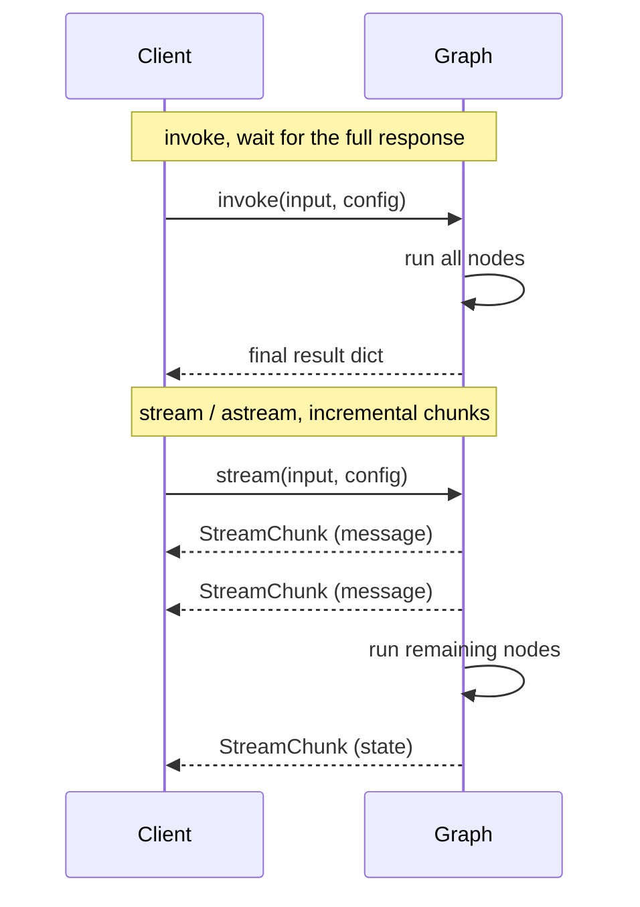

10xGraph provides three execution modes for agents: **invoke** to wait for the final result, **stream** (sync generator) for incremental chunks in blocking code, and **astream** (async generator) for incremental chunks in async contexts. Streaming is essential for chat and realtime UIs where users expect to see model output appear token by token and tool results arrive as they complete.

---

## Why stream

Invoking a graph end-to-end blocks the caller until every node finishes. For interactive experiences, streaming reveals progress to the user while the graph is still running. The stream emits structured chunks as the model generates text, tools execute in parallel, and nodes complete. Your UI can show tokens as they arrive, tool calls as they're made, and state updates as they occur, rather than waiting for silence.

---

## How it works



Use **invoke** or **ainvoke** when you need the full result before proceeding ([reference](/docs/reference/python/graph#invoke)). Use **stream** or **astream** when the client should see partial responses immediately as they arrive. `stream()` is the sync form of `astream()` for blocking code; it yields the same chunks.

---

## StreamChunk model

Every streaming event is a `StreamChunk` Pydantic model with a discriminated event type:

```python
from tenxgraph.core.state.stream_chunks import StreamChunk, StreamEvent

class StreamChunk(BaseModel):
    event: StreamEvent          # "message" | "state" | "error" | "updates"
    message: Message | None     # populated for StreamEvent.MESSAGE
    state: AgentState | None    # populated for StreamEvent.STATE
    data: dict | None           # populated for StreamEvent.ERROR / UPDATES
    thread_id: str | None
    run_id: str | None
    metadata: dict | None
    timestamp: float            # UNIX timestamp
```

The `event` field determines which of the four data fields is populated. Match on it to handle each event type:

| `StreamEvent` | Meaning | Populated field | Use |
|---|---|---|---|
| `MESSAGE` | Model or tool output | `message` | Render text tokens, display tool calls |
| `STATE` | State after a node's messages are added | `state` | Show execution progress, update context |
| `ERROR` | Execution failed | `data` | Handle errors in the stream |
| `UPDATES` | Progress notes (graph, node and tool status) and pause notices | `data` | Show progress; detect a pause (`data["status"] == "interrupted"`) |

---

## Response granularity

`response_granularity` decides which chunks a stream yields and which keys `invoke` returns:

```python
from tenxgraph.utils import ResponseGranularity
```

| Value | Stream yields | `invoke` returns |
|---|---|---|
| `LOW` (default) | `MESSAGE` and `ERROR` chunks, plus pause notices | `messages`, `token_usage` |
| `PARTIAL` | Adds `STATE` chunks | Adds `context`, `summary` |
| `FULL` | Every chunk, including `UPDATES` progress and a final summary chunk | `messages`, `state`, `token_usage` |

---

## Asynchronous streaming

Use `astream()` inside async contexts (FastAPI, async tests, async notebooks):

```python
import asyncio
from tenxgraph.core.state import Message
from tenxgraph.utils import ResponseGranularity
from tenxgraph.core.state.stream_chunks import StreamEvent

async def main():
    inp = {"messages": [Message.text_message("Call get_weather for Tokyo.")]}
    config = {"thread_id": "astream-1", "recursion_limit": 10}

    async for chunk in app.astream(inp, config, ResponseGranularity.PARTIAL):
        if chunk.event == StreamEvent.MESSAGE and chunk.message is not None:
            print(chunk.message.text(), end="", flush=True)
        elif chunk.event == StreamEvent.STATE and chunk.state is not None:
            print(f"\n[state received, step={chunk.state.execution_meta.step}]")

asyncio.run(main())
```

---

## Stopping a stream

Request graceful cancellation of a running stream with `stop()` or `astop()`. The run checks for a stop before and after each node, and every second while a node runs, then saves the thread as stopped. `astop()` returns a status dict such as `{"ok": True, "running": True}` (see [reference](/docs/reference/python/graph#stop--astop)):

```python
# Stop from another coroutine or thread
await app.astop({"thread_id": "stream-1"})
```

---

## Transports

Streaming is available over multiple transport layers. Choose based on your deployment and client type:

### REST (NDJSON)

The HTTP `/v1/graph/stream` endpoint streams responses as newline-delimited JSON (NDJSON), one `StreamChunk` per line. Use this when you need a simple HTTP transport that works with any HTTP client (curl, fetch, axios) and no bidirectional connection.

See [Invoke and stream over REST](/docs/server/invoke-and-stream) for details and examples.

### WebSocket (turn-based)

The WebSocket `/v1/graph/ws` endpoint streams individual `StreamChunk` frames over a persistent WebSocket connection. Use this for lower-latency bidirectional communication on one persistent connection.

See [WebSocket streaming](/docs/server/websockets) for configuration, authentication, and close codes.

### WebSocket (realtime audio)

The WebSocket `/v1/graph/live` endpoint is a provider-neutral audio-to-audio bridge: binary frames carry PCM16 audio and JSON frames carry control messages and events, not `StreamChunk` objects. Use it only if your agent is built for continuous audio I/O.

See [Realtime audio agent](/docs/guides/use-realtime-audio) for integration details.

### AG-UI

The POST `/v1/ag-ui` endpoint implements the AG-UI (agentic UI) protocol for frameworks like CopilotKit. It streams events and tool results in the AG-UI format, and handles browser tool execution.

This transport is off unless `ag_ui.enabled` is set in your `10xgraph.json`, and needs the `ag-ui` extra (`pip install "10xgraph-api[ag-ui]"`).

---

## TypeScript client

From TypeScript, `TenxGraphClient.stream()` (HTTP) and `TenxGraphClient.wsStream()` (WebSocket) return async iterators of stream chunks, so you do not parse NDJSON or manage WebSocket frames yourself.

See [Stream responses in TypeScript](/docs/client/stream-responses) for code examples.

---

## Related concepts

- [State and messages](/docs/concepts/state-and-messages): The data structures carried in `StreamChunk`
- [Agents and tools](/docs/concepts/agents-and-tools): How agents emit messages during execution
- [Serving agents](/docs/concepts/serving-agents): Request lifecycle and the API server execution model
