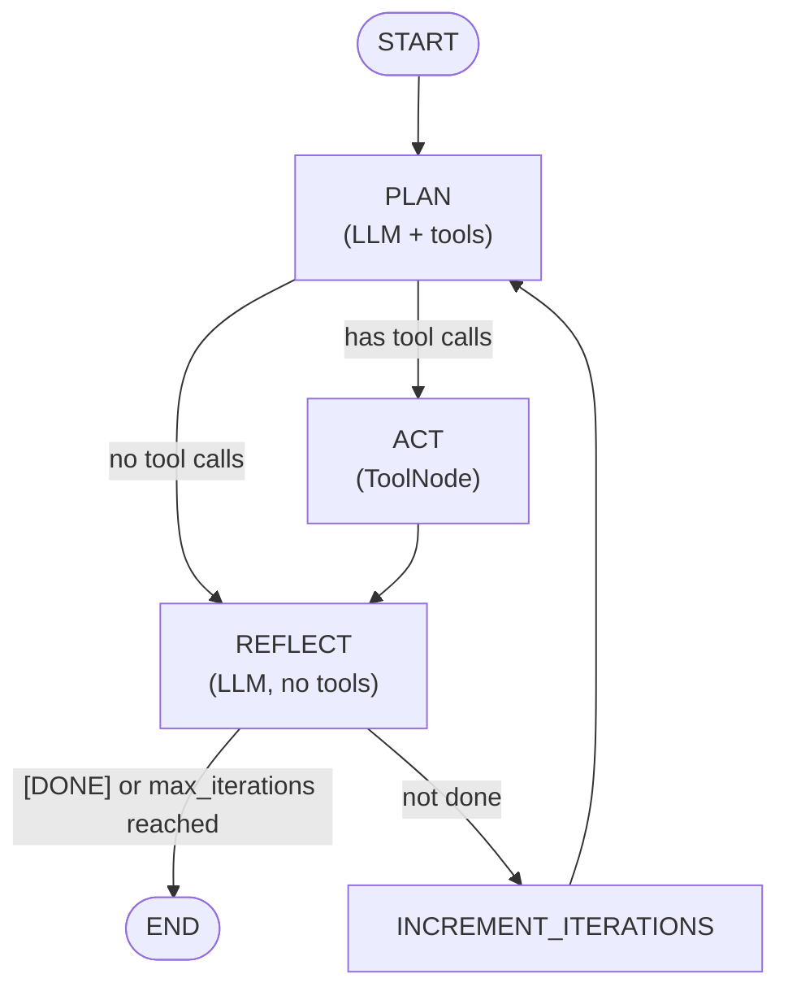

PlanActReflectAgent runs a planner, the planner's tools and a reflector in a loop. The reflector reviews the work after each round and ends the run with `[DONE]`; otherwise the planner gets another round, up to `max_iterations` per turn.

**Import path:** `from tenxgraph.prebuilt.agent import PlanActReflectAgent`

**Install:** `pip install "10xgraph[openai]"` (or `[google-genai]`, `[anthropic]` for other providers)

To choose between prebuilt agents and your own graph, see [Choosing a building block](/docs/concepts/choosing-a-building-block).

## How it works

The graph has two LLM nodes, PLAN and REFLECT, and one tool node, ACT.

### The graph topology



PLAN and REFLECT are separate `Agent` instances, each with its own system prompt:

| Node | Responsibility | Sees tools? | Output |
|---|---|---|---|
| **PLAN** | Break the task into steps; decide if tools are needed; emit tool calls or text | Yes | Tool calls and/or analysis |
| **ACT** | Run all requested tools in parallel (ToolNode) | n/a | Tool results |
| **REFLECT** | Review the complete work (plan + results); decide if done or if more work is needed | No | Completion signal (`[DONE]`) or guidance for next iteration |

### Routing decisions

**At PLAN:** If the planner emits tool calls, the graph routes to ACT; otherwise it routes directly to REFLECT. This branch lets the agent skip unnecessary tool execution when it can reason toward progress without external data.

**At REFLECT:** Two exit conditions:
1. The reflector's output contains `[DONE]` (case-insensitive): signals successful completion.
2. The iteration counter reaches `max_iterations` for the current turn: hard cap to prevent runaway loops.

If neither condition is met, the counter increments and the graph loops back to PLAN.

### The reflect filter

To prevent long tool outputs from overflowing context, tool result messages (messages with `role="tool"`) are hidden from the reflector. The planner still sees the full context on the next iteration, so information is not lost, only filtered from the critic's view.

Both prompts have built-in defaults (`DEFAULT_PLAN_SYSTEM_PROMPT` and `DEFAULT_REFLECT_SYSTEM_PROMPT` in `tenxgraph.prebuilt.agent.plan_act_reflect`); override them with `plan_system_prompt` and `reflect_system_prompt`.

## Options

The options you will reach for: `tools`, `max_iterations` (default `3`, counted per turn and kept when a paused or stopped run resumes), `plan_system_prompt`, `reflect_system_prompt`, `plan_model` and `reflect_model` (fall back to `model`), and `plan_reasoning_config` and `reflect_reasoning_config`. The other `Agent` options (`memory`, `retry_config`, `fallback_models`, `trim_context`, `client`, `mcp_auth`, `skills`, `tools_tags`, `extra_messages`, `multimodal_config`) apply to both inner agents, and extra keyword arguments such as `provider` go to both. `compile()` takes the same arguments as every prebuilt agent. Full tables: [prebuilt agents reference](/docs/reference/python/prebuilt-agents#planactreflectagent).

## Examples

### Research task with tools

This example demonstrates the full plan-act-reflect loop on a research task. The agent breaks the task into steps, searches for information, and iterates until it has a complete answer.

```python
import asyncio
from dotenv import load_dotenv
from tenxgraph.prebuilt.agent import PlanActReflectAgent
from tenxgraph.core.state import Message

load_dotenv()

def fetch_page(url: str) -> str:
    """Fetch a page. Replace with your own fetcher or an MCP server."""
    return f"Content of {url}"


def search_web(query: str) -> str:
    """Search the web. Replace with your search API or an MCP server."""
    return f"Results for: {query}"


def summarize_findings(text: str) -> str:
    """Compress a long text to key points."""
    return text[:2000] + "..." if len(text) > 2000 else text

agent = PlanActReflectAgent(
    model="gpt-4o-mini",
    provider="openai",
    tools=[fetch_page, search_web, summarize_findings],
    max_iterations=4,
)

app = agent.compile()

async def main():
    result = await app.ainvoke(
        {"messages": [Message.text_message(
            "Research the current state of fusion energy and write a 3-paragraph summary."
        )]},
        config={"thread_id": "research-1"},
    )
    print(result["messages"][-1].text())

asyncio.run(main())
```

### Custom system prompts

Override the default prompts to steer the agent's behavior. This is useful for domain-specific tasks or when you want precise instructions for planning and evaluation.

```python
from tenxgraph.prebuilt.agent import PlanActReflectAgent

# fetch_page and search_web as in the example above

agent = PlanActReflectAgent(
    model="gpt-4o",
    provider="openai",
    tools=[fetch_page, search_web],
    max_iterations=5,
    plan_system_prompt=[{
        "role": "system",
        "content": "You are a systematic researcher. Break each task into numbered steps.",
    }],
    reflect_system_prompt=[{
        "role": "system",
        "content": (
            "Review the work done. Is the research complete and accurate? "
            "If yes, write a summary and end with [DONE]. "
            "If not, list exactly what is still missing."
        ),
    }],
)
```

## Customization

### Per-phase model selection

You can use different models for planning and reflection to balance cost and capability:

```python
agent = PlanActReflectAgent(
    model="gpt-4o-mini",          # default for both phases
    plan_model="gpt-4o",          # stronger planner
    plan_reasoning_config={"effort": "high"},
    reflect_reasoning_config=False,  # no extended reasoning for the reflector
    tools=[search_web],
)
```

To pause before a node, compile with `interrupt_before=["REFLECT"]` and resume as shown in [Add human approval](/docs/guides/add-human-approval).

---

## Run it in production

`max_iterations` counts one turn and resets when the next turn starts, so cost per request stays bounded on a long-lived thread. Serve it with a durable checkpointer passed to `compile()`. See [Errors and limits](/docs/concepts/errors-and-limits) and [Scaling and reliability](/docs/production/scaling).

## See also

- **Full reference:** `/docs/reference/python/prebuilt-agents`: comprehensive parameter tables.
- **Other prebuilt agents:** `/docs/guides/prebuilt-agents`: ReactAgent, RAGAgent, SwarmAgent, and more.
- **Checkpointing:** `/docs/guides/set-up-checkpointing`: persist state and resume conversations.
- **Tools:** `/docs/guides/use-tool-decorator`: define custom tools for your agent.
- **Streaming:** `/docs/guides/stream-graph`: handle partial results and token-by-token output.
