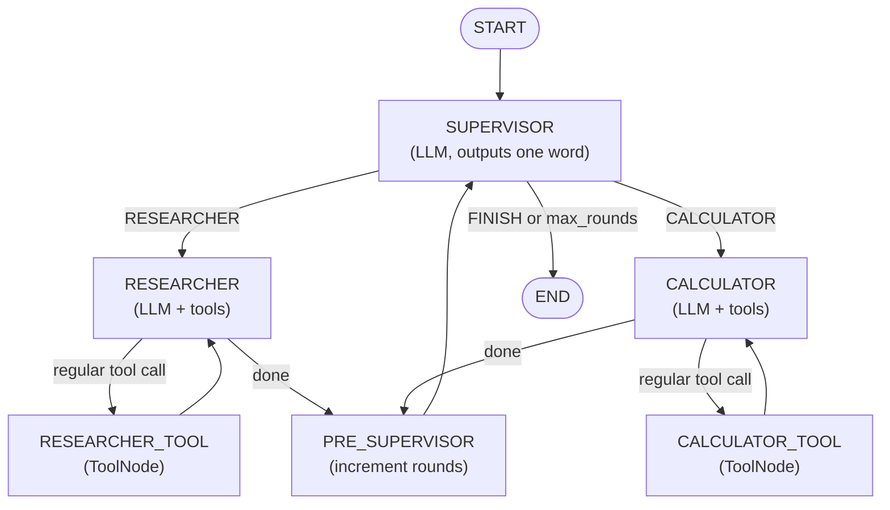

SupervisorTeamAgent implements a centralized orchestration pattern where a single supervisor LLM makes all routing decisions between specialist worker agents. Each worker is a fully independent Agent configured with its own model, tools, and system prompt. The supervisor's only output is the name of the next worker to invoke or FINISH when the task is complete.

**Import path:** `tenxgraph.prebuilt.agent`

To choose between a supervisor, a swarm and your own graph, see [Choosing a building block](/docs/concepts/choosing-a-building-block) and [Handoff between agents](/docs/guides/handoff-between-agents).

## How the graph works

The pattern consists of five node types:

**SUPERVISOR** - An LLM that analyzes the conversation and outputs exactly one word: a worker name or FINISH. Its system prompt is auto-generated from the worker registry (or you can override it).

**PRE_SUPERVISOR** - A lightweight state manager that increments the round counter before returning control to the supervisor. This keeps the hard-cap check decoupled from worker logic.

**WORKER nodes** - Each worker is a pre-built Agent node. When a worker finishes generating text, it returns to PRE_SUPERVISOR.

**WORKER_TOOL nodes** - When a worker emits tool calls, those calls route to a ToolNode, then back to the worker for reflection. Each worker gets its own mini ReAct loop.

**END** - The conversation terminates when the supervisor outputs FINISH (matched as a whole word, so a worker name that merely contains it does not end the run) or when max_rounds is reached.

### Visual example (two-worker team)



A worker without tools has no `<NAME>_TOOL` node and returns straight to PRE_SUPERVISOR.

---

## Auto-generated supervisor prompt

The supervisor prompt is built from the worker names and their `description` fields and asks for exactly one worker name or `FINISH`. Pass `supervisor_system_prompt` to replace it.

Key options: `supervisor_model`, `workers` (a dict of name to `WorkerConfig(agent, description)`; upper-case names recommended), `supervisor_system_prompt`, and `max_rounds` (default `10`, counted per turn). Extra keyword arguments such as `provider` go to the supervisor `Agent` only; each worker is configured on its own `Agent`. Full tables: [prebuilt agents reference](/docs/reference/python/prebuilt-agents#supervisorteamagent).

---

## Complete example: research and calculator team

This example creates a two-worker team: a researcher with a search tool and a calculator. The supervisor decides which worker should handle each part of the task.

```python
import asyncio
from dotenv import load_dotenv
from tenxgraph.core.graph import Agent, ToolNode
from tenxgraph.prebuilt.agent import SupervisorTeamAgent, WorkerConfig
from tenxgraph.core.state import Message

load_dotenv()

def search_web(query: str) -> str:
    """Search the web. Replace with your search API or an MCP server."""
    return f"Results for: {query}"


def multiply(a: float, b: float) -> float:
    """Multiply two numbers."""
    return a * b


workers = {
    "RESEARCHER": WorkerConfig(
        agent=Agent(
            model="gpt-4o-mini",
            provider="openai",
            tool_node=ToolNode([search_web]),
            system_prompt=[{
                "role": "system",
                "content": "Search the web and return factual results."
            }],
        ),
        description="Searches the web and returns factual information.",
    ),
    "CALCULATOR": WorkerConfig(
        agent=Agent(
            model="gpt-4o-mini",
            provider="openai",
            tool_node=ToolNode([multiply]),
            system_prompt=[{
                "role": "system",
                "content": "Do the arithmetic with the multiply tool."
            }],
        ),
        description="Performs arithmetic.",
    ),
}

agent = SupervisorTeamAgent(
    supervisor_model="gpt-4o",
    provider="openai",
    workers=workers,
    max_rounds=8,
)

app = agent.compile()

async def main():
    result = await app.ainvoke(
        {"messages": [Message.text_message(
            "Find the current price of Bitcoin, then calculate how much $1000 "
            "would be worth if BTC doubles."
        )]},
        config={"thread_id": "supervisor-1"},
    )
    print("Final output:", result["messages"][-1].text())

asyncio.run(main())
```

Install the extra the example uses and run it with your OpenAI API key set in the environment:

```bash
pip install "10xgraph[openai]"
python supervisor_team_example.py
```

---

## Customization

### Override the supervisor prompt

By default, the supervisor prompt is built automatically. To enforce a specific routing policy or add constraints, override it:

```python
agent = SupervisorTeamAgent(
    supervisor_model="gpt-4o",
    provider="openai",
    workers=workers,  # the same dict of WorkerConfig as in the example above
    supervisor_system_prompt=[{
        "role": "system",
        "content": (
            "You manage a RESEARCHER and a CALCULATOR. Research first, then use the "
            "CALCULATOR only if arithmetic is needed. Reply with one word: "
            "RESEARCHER, CALCULATOR or FINISH."
        ),
    }],
    max_rounds=6,
)
```

### Mix different LLM providers

The supervisor and workers are independent Agents, so they can use different providers. Use `**supervisor_kwargs` to configure only the supervisor:

```python
agent = SupervisorTeamAgent(
    supervisor_model="gemini-2.5-flash",
    provider="google",  # applies to the supervisor only
    workers=workers,    # each worker's Agent sets its own provider
)
```

---

## How routing works

The supervisor routing function uses word-boundary regex to match worker names, preventing partial matches. For example, if you have workers named `CODE` and `CODER`, a supervisor response containing `CODER` will match `CODER`, not `CODE`. If the supervisor response does not contain any recognized worker name or FINISH, the conversation terminates and a warning is logged.

The round counter is per turn and resets when a new message arrives after a completed run or a run that ended in an error. When `max_rounds` is reached, the supervisor is bypassed and the graph terminates immediately.

## Run it in production

`max_rounds` counts one turn and resets on the next, which bounds the model calls one request can trigger. Serve it with a durable checkpointer passed to `compile()` and a rate limit. See [Rate limiting](/docs/server/rate-limiting) and [Scaling and reliability](/docs/production/scaling).
