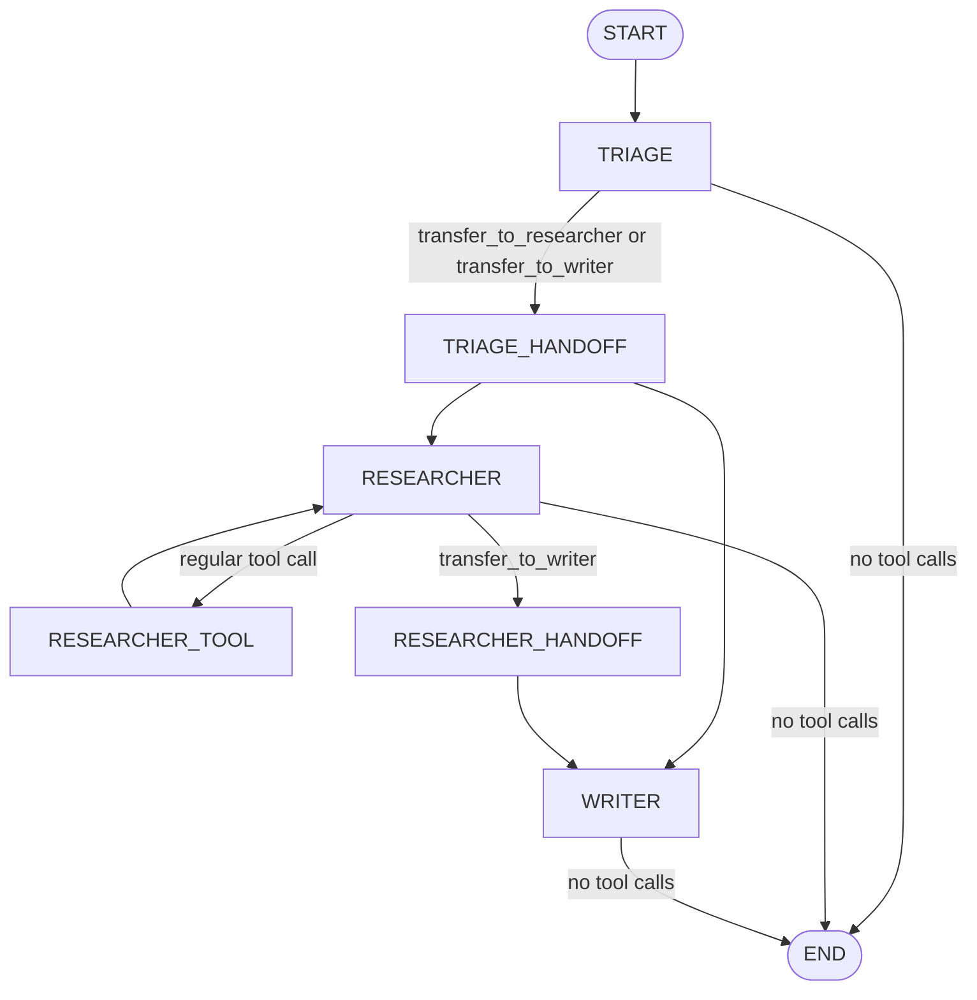

SwarmAgent implements a peer-to-peer multi-agent pattern where any agent can hand off control directly to any other agent. Unlike supervisor-based architectures with a single coordinator routing all work, swarms distribute decision-making across members. This produces flexible, decentralized workflows with no central bottleneck, each member acts independently and delegates when it determines another member is better suited for the task.

**Import path:** `tenxgraph.prebuilt.agent`

For choosing between a swarm, a supervisor and your own graph, see [Choosing a building block](/docs/concepts/choosing-a-building-block). How handoff tools work in a hand-built graph is in [Handoff between agents](/docs/guides/handoff-between-agents).

## How SwarmAgent works

Each member is a fully independent agent, a pre-built `Agent` instance with its own model, tools, memory, and skills. SwarmAgent wires them together with automatic handoff tools (`transfer_to_<member_name>`) that any member can call.

### Full graph, three-member example



### Routing

After each member runs, its routing function reads the member's last message:

1. **An allowed handoff call only** (`transfer_to_<member>`): go to `<NAME>_HANDOFF`, which answers every tool call of that message with a tool result ("Transferred to <target>. ...") and routes to the target. The target never inherits an unanswered tool call, which providers reject.
2. **A handoff plus regular tool calls**: go to `<NAME>_TOOL`, which runs the regular calls, answers the handoff and jumps to the target, so the target sees the results.
3. **Regular tool calls only**: `<NAME>_TOOL`, then back to the same member.
4. **No tool calls**: `END`.

Only targets allowed by `can_handoff_to` get a handoff tool. A call to any other `transfer_to_*` name is an unknown tool call and is not routed.

### Handoff tools injected automatically

SwarmAgent generates `transfer_to_<member_name>` (lowercase member name) tools for each member's allowed targets and injects them into the member's `ToolNode`. These are made with `create_handoff_tool`; the routing above answers the call and moves to the target.

Each handoff tool's docstring includes the target member's `description` field, so the LLM understands when and why to route there. For example, if RESEARCHER has `description="Gathers facts from the web"`, the handoff tool is named `transfer_to_researcher`, takes no arguments, and carries "Gathers facts from the web" as its description.

### Controlling handoff targets with `can_handoff_to`

| Setting | Behavior |
|---|---|
| `None` (default) | Member can hand off to all other members |
| `["A", "B"]` | Member can hand off only to A and B (case-insensitive; normalized to uppercase) |
| `[]` | Terminal member, no handoffs allowed; always routes to END after tools |

Setting `can_handoff_to=[]` creates a terminal member that always ends the swarm, useful for a final writer or decision-maker that should not pass control further.


## Member configuration

Each member is described by a `SwarmMemberConfig`:

| Field | Type | Default | Description |
|---|---|---|---|
| `agent` | `BaseAgent` | required | A fully-configured `Agent` instance. Do not pre-add handoff tools to its `tool_node`; SwarmAgent injects them. |
| `can_handoff_to` | `list[str] \| None` | `None` | List of member names this member may hand off to. `None` means all other members. `[]` means no handoffs (terminal). |
| `description` | `str` | `""` | Short description of this member's role (e.g., "Gathers facts from the web"). Injected into handoff tool docstrings of other members so the LLM knows when to route here. |

`SwarmAgent(members, entry, ...)` takes the member dict and the name of the member that gets the first message (`ValueError` if `entry` is not a member). Member names match case-insensitively; two names that differ only in case raise `ValueError`. Full tables: [prebuilt agents reference](/docs/reference/python/prebuilt-agents#swarmagent).


## Complete examples

### Basic three-member research workflow

Build a swarm where a triage agent routes research and writing tasks, a researcher gathers facts, and a writer produces the final document. This example shows the full pattern: custom tools, member independence, and handoff routing.

The examples use OpenAI models and small stand-in tools, so install the OpenAI extra:

```bash
pip install "10xgraph[openai]"
```

```python
import asyncio
from dotenv import load_dotenv
from tenxgraph.core.graph import Agent, ToolNode
from tenxgraph.prebuilt.agent import SwarmAgent, SwarmMemberConfig
from tenxgraph.core.state import Message

load_dotenv()

def fetch_page(url: str) -> str:
    """Fetch a page. Replace with your own fetcher or an MCP server."""
    return f"Content of {url}"


def search_web(query: str) -> str:
    """Search the web. Replace with your search API or an MCP server."""
    return f"Results for: {query}"


def draft_report(topic: str, facts: str) -> str:
    """Draft a structured report from gathered facts."""
    return f"# Report: {topic}\n\n{facts}"

triage_agent = Agent(
    model="gpt-4o-mini",
    provider="openai",
    system_prompt=[{
        "role": "system",
        "content": (
            "You are a triage agent. Decide whether the task needs research "
            "or can go directly to the writer. Route accordingly."
        ),
    }],
)

researcher_agent = Agent(
    model="gpt-4o",
    provider="openai",
    tool_node=ToolNode([fetch_page, search_web]),
    system_prompt=[{
        "role": "system",
        "content": "You are a research specialist. Gather facts and hand off to the writer.",
    }],
)

writer_agent = Agent(
    model="gpt-4o-mini",
    provider="openai",
    tool_node=ToolNode([draft_report]),
    system_prompt=[{
        "role": "system",
        "content": "You are a writer. Produce the final document from the gathered information.",
    }],
)

swarm = SwarmAgent(
    members={
        "TRIAGE": SwarmMemberConfig(
            agent=triage_agent,
            can_handoff_to=["RESEARCHER", "WRITER"],
            description="Triages the request and routes to the right specialist.",
        ),
        "RESEARCHER": SwarmMemberConfig(
            agent=researcher_agent,
            can_handoff_to=["WRITER"],
            description="Gathers facts from the web. Use for research tasks.",
        ),
        "WRITER": SwarmMemberConfig(
            agent=writer_agent,
            can_handoff_to=[],  # terminal, no handoffs out
            description="Writes the final document.",
        ),
    },
    entry="TRIAGE",
)

app = swarm.compile()

async def main():
    result = await app.ainvoke(
        {"messages": [Message.text_message(
            "Write a brief report on quantum computing progress in 2024."
        )]},
        config={"thread_id": "swarm-1"},
    )
    print(result["messages"][-1].text())

asyncio.run(main())
```

Omit `can_handoff_to` to let a member hand off to every other member. Members are independent `Agent` instances, so each can use its own model, provider, tools, memory and skills.

## Troubleshooting

**Common issues:**

- **Members do not hand off**: Check that `can_handoff_to` is set correctly and includes the target member name (case-insensitive). If empty, the member is terminal.
- **Handoff tool not in docstring**: Ensure the target member has a non-empty `description`. Handoff tools inherit their docstring from it so the LLM knows when to route there.
- **LLM gets confused about who to call**: Keep descriptions short and distinct. "Gathers facts" and "Analyzes data" are clearer than "Does stuff."
- **Token limits**: Long lists of handoff tools (20+ members) can exceed model context. Consider a two-tier swarm (triage agent routes to team leads, then to specialists) or using a custom graph instead.

## Run it in production

Handoffs are limited to the members each one may hand off to; a call to any other target is an unknown tool call. See the [Security model](/docs/production/security-model).
