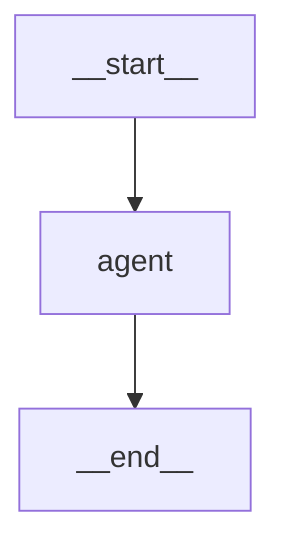

Call `generate_graph()` on a compiled graph, or `GET /v1/graph` on the server, to get its nodes and edges as JSON, then render them as a diagram.

## Inspect the graph locally

Once your graph is compiled, call `generate_graph()` to retrieve its structure as a JSON-compatible dictionary.

Install the provider extra used by the sample: `pip install "10xgraph[google-genai]"`.

```python
from tenxgraph import StateGraph, Agent, END
from tenxgraph.core.state import AgentState

# Build a simple graph
graph = StateGraph(AgentState)

agent = Agent(model="gemini-2.5-flash", provider="google")
graph.add_node("agent", agent)

def route_to_end(state):
    return "end"

graph.add_conditional_edges("agent", route_to_end, {"end": END})
graph.set_entry_point("agent")

# Compile the graph
compiled = graph.compile()

# Inspect the structure
graph_data = compiled.generate_graph()

print(graph_data)
```

The returned dictionary contains three sections:

**`nodes`**: A list of every node in the graph. Each node has an `id` (a random UUID generated on each call) and `name` (the node's label). The name matches what you passed to `add_node()`. The list always includes the built-in `__start__` and `__end__` nodes.

**`edges`**: A list of connections between nodes. Each edge has an `id`, a `source` node name, and a `target` node name. Edges include explicit edges (from `add_edge()`), the `__start__` edge created by `set_entry_point()`, and conditional edges (from `add_conditional_edges()`), which appear as one edge per `path_map` entry. Edges carry no label, so the router condition itself is not visible.

**`info`**: Metadata about the graph, including:
- `node_count` and `edge_count`: totals
- `checkpointer` and `checkpointer_type`: persistence configuration
- `publisher` and `store`: whether each is configured
- `state_type` and `state_fields`: the state shape
- `models`: per Agent node with a `model_registry`, its `default` entry, the `names` a run may pick and the `config_key` that carries the name. Names only, no keys or URLs. See [Model registry](/docs/reference/python/agent#model-registry)
- `interrupt_before` and `interrupt_after`: human-in-the-loop settings
- `context_type`, `id_generator` and `id_type`: runtime configuration

Example output:

```json
{
  "nodes": [
    {"id": "3f0c...", "name": "__start__"},
    {"id": "9a41...", "name": "__end__"},
    {"id": "c7d2...", "name": "agent"}
  ],
  "edges": [
    {"id": "51be...", "source": "__start__", "target": "agent"},
    {"id": "e08f...", "source": "agent", "target": "__end__"}
  ],
  "info": {
    "node_count": 3,
    "edge_count": 2,
    "checkpointer": true,
    "checkpointer_type": "InMemoryCheckpointer",
    "state_type": "AgentState",
    "state_fields": ["context", "context_summary", "execution_meta"]
  }
}
```

## Retrieve the graph from the API server

If you are running 10xGraph as a FastAPI server, you can fetch the compiled graph structure over HTTP without needing direct access to the Python code.

```bash
curl http://localhost:8000/v1/graph \
  -H "Authorization: Bearer YOUR_JWT_TOKEN"
```

The response wraps the same structure as `generate_graph()` in a `data` envelope, plus an additional `is_realtime` field in `info` that indicates whether the agent is a realtime/live agent (driven over `/v1/graph/live`). The `Authorization` header is only needed when auth is configured.

## Render the graph as a diagram

The nodes and edges are plain JSON, so any visualization library can render them.

### Convert to Mermaid

Mermaid is a plain-text diagram syntax supported by GitHub, Confluence, and Notion. You can programmatically convert your 10xGraph output to Mermaid:

```python
def graph_to_mermaid(graph_data):
    """Convert generate_graph() output to Mermaid diagram syntax."""
    lines = ["graph TD"]
    
    for edge in graph_data["edges"]:
        source = edge["source"]
        target = edge["target"]
        # Escape special characters in node names
        source = source.replace("-", "_")
        target = target.replace("-", "_")
        lines.append(f'  {source} --> {target}')
    
    return "\n".join(lines)

# Usage
mermaid_code = graph_to_mermaid(graph_data)
print(mermaid_code)
# Output (shape):
# graph TD
#   __start__ --> agent
#   agent --> __end__
```

Paste the output into a Markdown file or Mermaid editor to visualize it:



`generate_graph()` does not include edge labels, so conditional routes render as plain arrows.

## Run it in production

The server exposes the graph structure through a read-only endpoint that needs the `graph:read` permission, so you can limit who sees your node names and edges. See [Server auth](/docs/server/auth) and [Configure the server](/docs/server/configure).

## Next steps

- Learn more about [graph structure and state](/docs/concepts/state-graph) to understand the nodes and edges you are visualizing.
- Configure [routing and conditional edges](/docs/guides/build-a-graph#conditional-routing-patterns) in your graph.
- Set up [human-in-the-loop interrupts](/docs/guides/add-human-approval) to pause execution at specific nodes.
