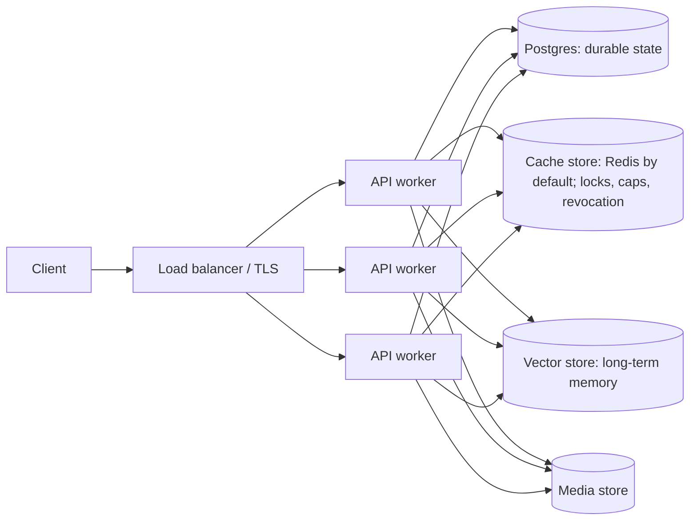

A served 10xGraph agent is a stateless FastAPI worker in front of a graph, with all durable state in the stores you attach: a checkpointer (Postgres, with an optional Redis cache), an optional vector memory store, and a media store. Every request passes the same ordered set of middleware and guards before your graph runs, so you write the graph and the server supplies the rest. This page walks that path and shows where each kind of state lives.

## The shape of a deployment

Workers hold no conversation state between requests. They hold caches (a short-lived thread-ownership cache) and, with the in-memory cache store, per-process counters, which is why a shared cache store (Redis by default) matters once you run more than one worker. See [Scaling and reliability](/docs/production/scaling) for exactly what it shares, and [Bring your own backend](/docs/server/bring-your-own-backend) for replacing it.

## The request path

This is the order a request travels, outermost layer first. The middleware order comes from `setup_middleware.py`, which adds layers so that the response from any inner layer (a 429, a 413, a rejected Host) still passes back out through CORS, the request id and the security headers.

| Step | Layer | What it does |
|---|---|---|
| 1 | CORS | Applies your `ORIGINS`. In production, wildcard origins with credentials refuse to start. |
| 2 | Request id | Adds `X-Request-ID` and `X-Timestamp` to every response. |
| 3 | Security headers | Adds HSTS, frame, content-type and CSP headers when `SECURITY_HEADERS_ENABLED` is on. |
| 4 | Trusted host | Rejects Host headers outside `ALLOWED_HOST`. `/ping` and `/health/ready` skip this check so probes on `localhost` or a pod IP still work. |
| 5 | Rate limit | Runs only when `rate_limit` is set in `10xgraph.json`. Counters live in the API's cache store (in-memory, Redis or your own). |
| 6 | Request size | Rejects bodies over `MAX_REQUEST_SIZE`. The upload route gets room for `MEDIA_MAX_SIZE_MB`. |
| 7 | Gzip | Compresses responses over 1000 bytes, except `/v1/graph/stream`, which must send data as it is produced. |
| 8 | Route guard | `RequirePermission` authenticates the caller (JWT or your `BaseAuth`), checks token revocation if configured, then asks the authorization backend. The default `ownership` backend lets a thread be read or run only by its owner. A foreign thread is a 403 before the graph is touched. |
| 9 | Per-thread run lock | One run at a time on a thread. A busy thread is waited on for up to 30 seconds, then a 409. `on_busy: "cancel"` asks the active run to stop first. |
| 10 | Per-user run cap | `runs.max_concurrent_per_user` (default 10) bounds runs in flight for a user. Over the cap is a 429. |
| 11 | Graph run | Your compiled graph runs, bounded by `runs.timeout` if set (invoke returns 504, a stream ends with an error chunk). |
| 12 | Nodes and tools | Each node and tool call can have its own timeout (`node_timeout` and `tool_timeout`, no default), and tools run in parallel up to a cap (default 10). |
| 13 | Persistence | The checkpointer saves state at each step. Stores and media are read and written as the graph asks. |

Both lock and cap are taken before the response starts, so a busy or over-cap request gets a real 409 or 429 status, not an error halfway through a stream. See [Security model](/docs/production/security-model) for what steps 3, 4, 8 and 9 protect against.

## Where state lives

10xGraph keeps state in layers, each with one owner.

| Layer | What it holds | Owner | Lifetime |
|---|---|---|---|
| Working state | The `AgentState` for the run in progress: messages, your custom fields. | The graph run, in the worker's memory | One run |
| Redis hot cache | A copy of each thread's latest state, so a resumed run does not read Postgres. | `PgCheckpointer` | TTL, 24 hours by default (`cache_ttl`) |
| Postgres | Durable thread history. Each write appends a new version under a per-thread row lock; a write based on an out-of-date version raises `StaleStateError` and the API returns 409. Also the tool-call ledger. | `PgCheckpointer` | Until you delete the thread |
| Vector memory store | Long-term memory across threads (Qdrant or Mem0). | The `BaseStore` you pass to the graph, served at `/v1/store` | Until you delete it |
| Media store | Uploaded and generated files, referenced by `graph://media/` URLs. | The media store you configure | Until deleted; by default a file is deleted with the last thread that references it (`media.delete_with_thread`) |

Postgres is the source of truth. Redis is a cache and a coordination tool, not a second copy you must back up. The server uses the checkpointer you pass to `graph.compile(checkpointer=...)`; the `checkpointer` key in `10xgraph.json` is not read. For the full model see [Checkpointing and threads](/docs/concepts/checkpointing-and-threads).

## Stateless and stateful parts

| Stateless (scale out freely) | Stateful (you operate and back up) |
|---|---|
| API workers (Gunicorn with Uvicorn workers in the `10xgraph build` image) | Postgres |
| Your graph, tools and prompts, rebuilt from code on start | Redis, when you use it for cache, shared locks and caps |
| | Vector store, if you use long-term memory |
| | Media store |

Because a thread's state is in the checkpointer, a request can land on any worker, including after a deploy or a crash. A run in flight when a worker dies is resumed by sending the thread another request; finished tool calls are not run again (see [Replay-safe tools](/docs/concepts/replay-safe-tools)).

## What this does not give you

- Runs execute inside the worker that received the request. There is no separate queue or worker tier, so a run is tied to its HTTP or WebSocket connection's process.
- With `auth: null` the server starts open, even with `MODE=production`. Configure auth before you expose it. See [what 10xGraph does not protect](/docs/production/limits).

## Related

- [Scaling and reliability](/docs/production/scaling)
- [Production checklist](/docs/server/production-checklist)
- [Serving agents](/docs/concepts/serving-agents)
