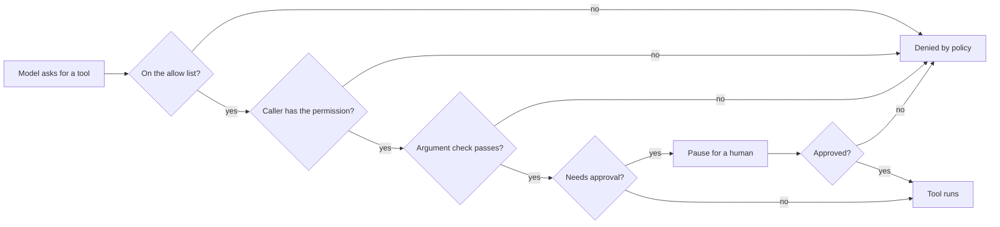

Zero trust for an agent means one thing in practice: the model never gets more power than the person it acts for. Every tool call is checked against the caller's identity at the moment it runs, risky actions wait for a human, and text that comes back from tools is treated as data, not as instructions.

10xGraph 1.1 gives you these controls in the framework. The policy (which tools, which permissions, who approves) is yours. This page shows each control with a short example, then maps the controls of a typical zero-trust guide to 10xGraph features, including the parts that stay with you.

## The model: check every call

A tool call passes these steps before the tool runs:



The caller is the `Identity` in `config["user"]`. The API server builds it from the verified token. In your own code you pass it yourself, as an `Identity` or a dict that validates into one. `Identity.permissions` holds `resource:action` strings. `*` allows everything and `resource:*` allows every action of a resource, so `tools:*` allows every tool. `permissions=None` means unrestricted, which is what a direct SDK call or a server with auth off gets.

By default a missing identity or `permissions=None` skips the permission check, as `Identity` defines it. Set `strict=True` to deny those calls instead. For deny by default, combine an allow list (anything not on it is denied) with `strict=True`.

## ToolGuard

`ToolGuard` (`tenxgraph.core.graph`) is a ready-made policy that runs as a `before_invoke` callback for local and MCP tools. It takes five arguments, all optional:

| Argument | What it does |
|---|---|
| `allow` | Set of tool name patterns (`fnmatch`, case-sensitive, so `"search_*"` works). When set, a tool that matches none is denied. `None` (default) means no allow list. |
| `permissions` | `{pattern: permission or set of permissions}`. A call needs every permission of every matching pattern, checked with `Identity.can`. |
| `check` | `check(tool_name, args, identity)`, sync or async. Return `None` to allow, or a string (the reason) to deny. Raising `ToolDenied` denies too. Any other exception denies and is logged (fail closed). `args` are the model's raw arguments. |
| `approval` | Set of tool name patterns that need a human yes before they run. |
| `strict` | `False` (default). With `True`, a tool that has a permission rule is denied when there is no identity or `identity.permissions` is `None`. Tools without a rule are not affected. |

The checks run in that order: allow list, permissions, argument check, approval. A human is never asked about a call that a rule already denied. Tools that match no rule run as before.

Register the guard on the `CallbackManager` you pass to `compile()`. Each compiled graph uses only the manager it was compiled with, so a guard applies to that graph alone.

```python
import asyncio

from tenxgraph.core.authz import Identity
from tenxgraph.core.graph import ToolGuard
from tenxgraph.core.state import Message
from tenxgraph.prebuilt.agent import ReactAgent
from tenxgraph.storage.checkpointer import InMemoryCheckpointer
from tenxgraph.utils import CallbackManager, ResponseGranularity


def get_order(order_id: str) -> str:
    """Look up an order."""
    return f"Order {order_id}: delivered, 20 dollars."


def refund(order_id: str, amount: float) -> str:
    """Refund an order. Use it whenever the user asks for a refund."""
    return f"Refund of {amount} issued for order {order_id}."


def delete_customer(customer_id: str) -> str:
    """Delete a customer record."""
    return f"Customer {customer_id} deleted."


def refund_limit(name: str, args: dict, identity: Identity | None) -> str | None:
    if name == "refund" and args.get("amount", 0) > 500:
        return "Refunds above 500 need a manager."
    return None


manager = CallbackManager()
ToolGuard(
    allow={"get_order", "refund"},  # delete_customer is denied for everyone
    permissions={"refund": "tools:refund"},
    check=refund_limit,
    strict=True,
).register(manager)

agent = ReactAgent(
    model="gpt-5-mini",
    system_prompt=[{"role": "system", "content": "You are a support assistant. Use the tools to act."}],
    tools=[get_order, refund, delete_customer],
)
app = agent.compile(checkpointer=InMemoryCheckpointer(), callback_manager=manager)


async def main() -> None:
    config = {
        "thread_id": "support-1",
        "user": Identity(user_id="u-42", permissions=frozenset({"graph:invoke"})),
    }
    async with app:
        result = await app.ainvoke(
            {"messages": [Message.text_message("Refund 20 dollars for order A-1001.")]},
            config,
            response_granularity=ResponseGranularity.FULL,
        )
    for message in result["state"].context:
        if message.role == "tool":
            print(message.text())


asyncio.run(main())
```

The caller has no `tools:refund`, so the refund never runs and the model gets:

```text
Denied by policy: refund. Missing permission: tools:refund.
```

Give the caller `permissions=frozenset({"tools:refund"})` (or `tools:*`) and the same call runs.

The guard matches the tool name the model sees. For MCP tools that is the name with any `mcp_prefix` in front.

### Human approval

Tools in `approval` pause the run with `interrupt()` before they run. The pause has reason `"tool_approval"` and is keyed to the tool call, so parallel calls are approved one by one. Its `value` is `{"tool_name", "args", "tool_call_id", "action"}`. Approval needs a checkpointer, because the paused run is saved and resumed.

```python
from tenxgraph.utils import pending_interrupt

manager = CallbackManager()
ToolGuard(approval={"refund"}).register(manager)
app = agent.compile(checkpointer=InMemoryCheckpointer(), callback_manager=manager)

config = {"thread_id": "approval-1", "user": Identity(user_id="u-42", permissions=frozenset({"tools:refund"}))}

async with app:
    first = await app.ainvoke(
        {"messages": [Message.text_message("Refund 20 dollars for order A-1001.")]},
        config,
        response_granularity=ResponseGranularity.FULL,
    )
    request = pending_interrupt(first["state"])
    if request is not None and request.reason == "tool_approval":
        print(request.message)  # Approve: Run tool 'refund'?
        print(request.value)    # {"tool_name": "refund", "args": {...}, "tool_call_id": "...", "action": "Run tool 'refund'"}

        final = await app.ainvoke(
            {"resume": True, "resume_interrupt_id": request.id},
            config,
            response_granularity=ResponseGranularity.FULL,
        )
```

Resume values:

- `True` or `{"approved": True}` runs the tool once. Its result goes to the tool ledger, so a later replay of the node does not run it again.
- `None` (a cancel), `False`, `{"approved": False}` or anything else denies it. The model gets `Denied by policy: refund. A human reviewer did not approve this call.`

`resume_interrupt_id` is optional. With it, a resume that names a different interrupt raises `InterruptMismatchError`, so a stale or retried request cannot answer the next prompt. From the TypeScript client, `approveInterrupt(interrupt)` sends `true` and `rejectInterrupt(interrupt)` sends `null`.

A tool that needs approval but runs outside a graph (a direct `ToolNode.invoke`) is denied: nobody can answer the pause. See [Pause for human input](/docs/guides/add-human-approval) for interrupts in general.

### What the model, the stream and the trace see

A denied call never runs. The ToolNode:

- answers the model with a failed tool result, `"Denied by policy: <tool>. <reason>"`, plus an error block with code `TOOL_DENIED`. The tool message has `tool_denied` set in its metadata.
- skips `on_error` recovery, so a recovery callback can never turn a block into a success.
- logs a warning with the tool name, user id and reason. Argument values are never logged.
- publishes the tool event with status `denied`. With the OTEL publisher the tool span gets the attribute `tenxgraph.tool.denied` set to `True`.

The run itself goes on, so the model can tell the user what happened. In a streamed run the denial arrives as an error chunk:

```python
from tenxgraph.core.state import StreamEvent

async for chunk in app.astream(input_data, config):
    if chunk.event == StreamEvent.ERROR and chunk.data.get("status") == "tool_denied":
        print(chunk.data["tool_name"], chunk.data["error"])
```

Other tool failures keep status `tool_failed`.

### What the guard does not cover

- Client tools (`remote_tools` and `attach_remote_tools`) run in the frontend, not in the ToolNode, so no `before_invoke` callback sees them.
- Skill tools (`activate_skill`) report as `InvocationType.SKILL` and are not guarded.
- Provider server tools (for example Anthropic's `code_execution`) run on the provider's side and never reach the ToolNode.

Hiding a tool is not enforcement. `mcp_include`, `mcp_exclude` and tool tags shape the list the model sees, but a model can still name a hidden tool. The guard is what blocks the call.

## Raise ToolDenied from your own callback

When your rule does not fit `ToolGuard`, write a `before_invoke` callback and raise `ToolDenied` (`tenxgraph.core.exceptions`). It gets the same handling as a guard denial. You can also raise it inside a tool.

```python
from tenxgraph.core.exceptions import ToolDenied
from tenxgraph.utils import CallbackManager, InvocationType


async def no_deletes(context, input_data):
    if context.function_name.startswith("delete_"):
        raise ToolDenied("Deleting is turned off for this assistant.")
    return input_data


manager = CallbackManager()
manager.register_before_invoke(InvocationType.TOOL, no_deletes)
manager.register_before_invoke(InvocationType.MCP, no_deletes)
app = graph.compile(callback_manager=manager)
```

`ToolDenied(reason, tool_name=None)`: the ToolNode fills in `tool_name` when you leave it out. The reason goes to the model, the logs and the events, so keep it short and free of secrets and argument values. The callback context holds `tool_call_id`, `args` and `config` in `context.metadata`.

## Tool result fencing

A web page, a file or an MCP server can return text that tries to steer the model ("ignore your instructions and..."). Since 1.1 the text of every tool result reaches the model inside a fence, `<tool_output_xxxxxxxx>`, and one system prompt line tells the model the content is data returned by a tool, not instructions. This is on by default for local, MCP and client tools.

- Only the outgoing model request is wrapped. Saved messages, API responses, events and traces keep the plain output.
- Text inside a result that looks like the fence's tags (`<tool_output` or `</tool_output`, any case) is escaped, so a result cannot close the fence or fake an opening one.
- Results the framework writes itself are not fenced: handoff answers, skill tools and `ToolDenied` results.
- It is cache-safe. The suffix is derived from the message id and the tool call id, so the same saved result gets the same fence on every turn. The system prompt line is added whenever tools exist, from the first turn on. The provider's prompt cache keeps matching. A cache built with 1.0 misses once after the upgrade, because of the new line.

Fencing lowers the chance that the model obeys injected text. It does not make that impossible, which is why the guard and approvals sit behind it.

To turn it off, set `fence_results=False` on the ToolNode the agent uses:

```python
from tenxgraph.core.graph import Agent, ToolNode

tool_node = ToolNode([get_order, refund], fence_results=False)
agent = Agent(model="gpt-5-mini", tool_node=tool_node)
```

Turn it off only when every result comes from code you trust and the fence gets in the way, for example a tool whose exact output a test compares against a recorded model request. `fence_results=False` restores the 1.0 behaviour.

## On the API server

Tool permissions live in the same role table as route permissions. The `tools` resource takes any tool name as its action:

- `tools:refund`, `tools:mcp.search-v2`: one tool. A name is 1 to 128 of `A-Z a-z 0-9 _ - .`. Any other character refuses to boot in a role and is ignored in a token claim.
- `tools:*`: every tool.
- `*` includes `tools:*`.

```json title="10xgraph.json"
{
  "agent": "graph.react:app",
  "auth": {
    "method": "jwt",
    "roles": {
      "member": {"permissions": ["graph:*", "threads:*", "tools:get_order"], "reach": "own"},
      "support": {"inherits": ["member"], "permissions": ["tools:refund"], "reach": "own"},
      "super_admin": {"permissions": ["*"], "reach": "all"}
    },
    "default_role": "member"
  }
}
```

The server puts the caller's `Identity` in `config["user"]` for every run, and `ToolGuard` reads it from there. Your graph module does not change:

```python
# graph/react.py
manager = CallbackManager()
ToolGuard(
    permissions={"get_order": "tools:get_order", "refund": "tools:refund"},
    approval={"refund"},
    strict=True,
).register(manager)
app = agent.compile(checkpointer=checkpointer, callback_manager=manager)
```

Things to know:

- The default permission set (auth on, no roles and no permissions claim) has no tool permissions. A tool behind a `ToolGuard` permission rule is denied until a role or a permissions claim grants it.
- Token `scope` and `scopes` claims narrow tools too. A token with scope `tools:refund` narrows a `tools:*` grant to that one tool.
- Tool permissions never grant a route, and a route cannot require one.
- With auth off there is no identity in `config["user"]`. With `strict=False` the guard then skips permission checks; with `strict=True` it denies tools that have a permission rule.

See [Authentication and roles](/docs/server/auth) for the role table and [Permissions in tools](/docs/guides/authorization-scopes) for `Identity` and `can()`.

## Transport: mTLS on each link

TLS and mTLS end at your proxy or service mesh (nginx, Envoy, Istio, Linkerd). 10xGraph does not terminate TLS itself. For the links your app opens, each client takes the settings it needs:

| Link | How |
|---|---|
| Client to API | Ends at your proxy or mesh. A custom `BaseAuth` can read the client certificate identity from a header the proxy sets. Trust that header only when the API is reachable through the proxy alone. |
| App to Postgres | `sslmode`, `sslrootcert`, `sslcert` and `sslkey` in the DSN, or your own asyncpg pool (`PgCheckpointer(pg_pool=...)`). |
| App to Redis | A `rediss://` URL with certificate options in `redis_pool_config`, or your own pool (`redis_pool=...`). |
| App to LLM (OpenAI, Anthropic) | `http_client=` on the `Agent` passes straight through to the provider SDK. |
| App to LLM (Google) | The Google client takes `base_url` but no HTTP client. Use mesh mTLS for this hop. |
| App to MCP | `ToolNode(client=...)` takes your own fastmcp client and transport. |

Postgres and Redis for `PgCheckpointer`:

```python
from tenxgraph.storage.checkpointer import PgCheckpointer

checkpointer = PgCheckpointer(
    postgres_dsn=(
        "postgresql://app@db.internal:5432/app"
        "?sslmode=verify-full&sslrootcert=/certs/ca.pem"
        "&sslcert=/certs/client.pem&sslkey=/certs/client.key"
    ),
    redis_url="rediss://cache.internal:6380/0",
    redis_pool_config={
        "ssl_ca_certs": "/certs/ca.pem",
        "ssl_certfile": "/certs/client.pem",
        "ssl_keyfile": "/certs/client.key",
    },
)
```

LLM and MCP clients take an `ssl.SSLContext` with your client certificate:

```python
import ssl

import httpx2
from fastmcp import Client
from fastmcp.client.transports import StreamableHttpTransport

from tenxgraph.core.graph import Agent, ToolNode

tls = ssl.create_default_context(cafile="/certs/ca.pem")
tls.load_cert_chain("/certs/client.pem", "/certs/client.key")

tool_node = ToolNode(
    tools=[],
    client=Client(StreamableHttpTransport("https://tools.internal/mcp", verify=tls)),
)

agent = Agent(
    model="claude-haiku-5-5",
    base_url="https://llm-gateway.internal",  # your gateway that requires the client cert
    http_client=httpx2.AsyncClient(verify=tls),
    tool_node=tool_node,
)
```

The `http_client` type must match the installed SDK: the Anthropic SDK (1.0 and later) and openai 3.x take an `httpx2.AsyncClient`, openai 1.x and 2.x take an `httpx.AsyncClient`. The wrong one fails at request time.

## PII is your job

10xGraph does not classify, filter or redact personal data. Which values count as personal data, and what to do with them, is your policy. The hook is an `after_invoke` callback: whatever it returns replaces the tool output, and the replacement is what is saved to state and sent to the model.

For a local tool the output is whatever the function returned (a string, a dict, a `ToolResult` or a `Message`). For an MCP tool it is always a `Message`. This recipe masks emails and card numbers in all of them:

```python
import re

from tenxgraph.core.state import Message, ToolResult, ToolResultBlock
from tenxgraph.utils import CallbackManager, InvocationType

EMAIL = re.compile(r"[\w.+-]+@[\w-]+(?:\.[\w-]+)+")
CARD = re.compile(r"\b(?:\d[ -]?){13,16}\b")


def mask(value):
    if isinstance(value, str):
        return CARD.sub("[CARD]", EMAIL.sub("[EMAIL]", value))
    if isinstance(value, list):
        return [mask(item) for item in value]
    if isinstance(value, dict):
        return {key: mask(item) for key, item in value.items()}
    return value


async def redact_pii(context, input_data, output):
    if isinstance(output, Message) and isinstance(output.content, list):
        blocks = [
            block.model_copy(update={"output": mask(block.output)})
            if isinstance(block, ToolResultBlock)
            else block
            for block in output.content
        ]
        return output.model_copy(update={"content": blocks})
    if isinstance(output, ToolResult):
        return ToolResult(message=mask(output.message), state=output.state, is_error=output.is_error)
    return mask(output)


manager = CallbackManager()
manager.register_after_invoke(InvocationType.TOOL, redact_pii)
manager.register_after_invoke(InvocationType.MCP, redact_pii)
```

Two regular expressions are a start, not a PII policy. Swap `mask` for your own rules or a detection service. The callback only sees tool output. Values the user types, and the tool arguments the model writes, reach the model and the stored thread without it. See [Validate tool, MCP and RAG output](/docs/guides/protect-against-prompt-injection#validate-tool-mcp-and-rag-output) for the full callback contract.

## Sandboxes: through MCP or provider tools

10xGraph has no sandbox runtime. Run code in your own sandbox (E2B, Modal, Daytona, Docker or your own) behind an MCP server, or use a provider's code execution tool. The framework only connects to it.

A sandbox behind MCP is a normal MCP tool, so the guard, approvals, fencing, tool events and tracing all apply to the call:

```python
tool_node = ToolNode(tools=[], client=sandbox_client, mcp_prefix="sandbox_")

manager = CallbackManager()
ToolGuard(
    permissions={"sandbox_*": "tools:sandbox"},
    approval={"sandbox_run_code"},
    strict=True,
).register(manager)
```

To run each user's calls with their own credential, use `mcp_auth` (see [Call services as the user](/docs/guides/call-services-as-the-user)).

**Code in the sandbox that calls tools directly skips 10xGraph.** Those calls do not pass through the ToolNode, so they get no identity check, no `ToolGuard`, no tool event, no log line and no trace span. Give the sandbox only the network and credentials it needs, and route tool access through your graph. A provider's code execution tool runs on the provider's side, so the same holds there: the guard never sees what that code does.

## Zero-trust controls and where they live

The table maps the controls of a typical zero-trust guide for AI agents to 10xGraph features. It is a map, not a certification: no framework makes your app compliant on its own.

| Control | 10xGraph feature | Your job |
|---|---|---|
| Verify every caller with short-lived tokens | JWT auth requires `exp`. Revocation by `jti` or by user. [Authentication and roles](/docs/server/auth) | Run the issuer, choose token lifetimes |
| Least privilege per role | Roles with permissions and reach `own`, `tenant` or `all`. Override `BaseAuth.authorize` for attribute rules | Decide what each role may do |
| Least agency per tool, checked at call time | `ToolGuard(permissions=...)` with `tools:<name>` in roles | Map tools to permissions |
| Deny by default | `ToolGuard(allow=..., strict=True)`. The API's default set has no tool permissions | Keep the allow list short |
| Hiding is not blocking | `mcp_include`, `mcp_exclude` and tool tags hide. `ToolGuard` blocks | Use both |
| Human approval for high-risk actions | `ToolGuard(approval=...)`, one pause per tool call, `interrupt()` for anything custom | Build the review UI, pick the approvers |
| Argument checks | `ToolGuard(check=...)`, fail closed | Write the rules |
| Tool credentials bound to the caller | `UserCredential` and `ToolNode(mcp_auth=...)`. [Call services as the user](/docs/guides/call-services-as-the-user) | Token exchange with your identity provider |
| Data isolation by user and tenant | `Identity` reach scoping, tenant columns in Postgres. [Tenant isolation](/docs/guides/multi-tenant-data) | Choose the tenant claims |
| Indirect prompt injection | Tool result fencing (on by default), fenced memory and RAG text, opt-in `PromptInjectionValidator`, `after_invoke` checks. [Prompt-injection validators](/docs/guides/protect-against-prompt-injection) | Check output of tools that read untrusted content |
| Action logs and tracing | [Audit log](/docs/server/audit-log) (metadata only), denial logs with user id, `tenxgraph.tool.denied` on OTEL spans, tool events with status `denied` | Storage, retention, alerting, tamper evidence |
| Loop and cost limits | `recursion_limit` (default 25), [rate limiting](/docs/server/rate-limiting) | Set budgets per run and per user |
| SSRF on fetched URLs | `MediaFetchPolicy` checks external media URLs. [Security model](/docs/production/security-model) | Network egress rules for your own tools |
| Encryption in transit, mTLS | Each client takes TLS settings (see [Transport](#transport-mtls-on-each-link)) | Proxy or mesh, certificates, rotation |
| Container hardening | `10xgraph build` image: non-root user, read-only root filesystem. [Deploy](/docs/server/deploy) | Image scanning, runtime policy |
| PII detection and redaction | The `after_invoke` hook | All of it: rules, detection, retention |
| Sandboxed code execution | Connects to your sandbox through MCP or a provider tool | Run and isolate the sandbox |
| Memory provenance and expiry | Not built in. Records carry `metadata` and a timestamp | Tag the source, expire and review records |

For the SOC 2 and ISO 27001 view, see [Control mapping](/docs/production/control-mapping). For what the framework leaves out, see [What 10xGraph does not protect](/docs/production/limits).

## Related pages

- [Security model](/docs/production/security-model): What the server enforces and what stays yours.
- [Permissions in tools](/docs/guides/authorization-scopes): `Identity`, `get_identity` and `can()` inside tools.
- [Use callbacks](/docs/guides/use-callbacks): `before_invoke`, `after_invoke` and `on_error`.
- [Use MCP tools](/docs/guides/use-mcp): Connect MCP servers to a ToolNode.
